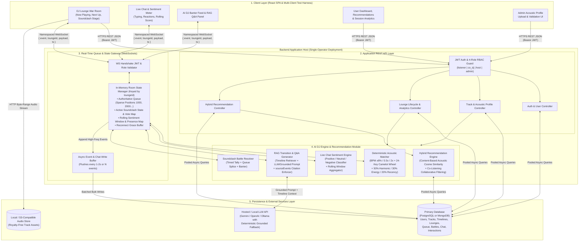

# System Architecture & Folder Structure (Module 0)

## 1. Architectural Philosophy & Design Principles

In accordance with **PRD Section 7.1** and **Section 9.4**, the **AI DJ Studio** system is designed around a **Modular Monolith with Logically Isolated Service Boundaries** composed of **five cooperating layers**. This satisfies all real-time latency targets (`< 100 ms` queue sync drift, `< 200 ms` REST P95, `< 3 s` AI segue P95) without introducing unnecessary distributed microservice network overhead for a single-engineer, four-week build, while preserving clean module interfaces so the **Queue & State Gateway** and **AI DJ Engine** can scale independently in the future (`REQ-050`).

### Key Architectural Decisions
1. **Five-Layer Separation (`REQ-050`):**
   - **Layer 1 — Client Layer (Track A React SPA + Scripted Multi-Client Simulator):** Renders the interactive DJ Console, War Room (`Now Playing`, `Next Up`, `Soundclash Stage`), live sentiment-aware chat, AI DJ banter feed/Q&A, Personal Dashboard, and Admin Acoustic Profile Upload portal.
   - **Layer 2 — Application REST API Layer:** Stateless HTTP/JSON controllers handling JWT Authentication, 4-Role RBAC enforcement, Track & Acoustic Catalog CRUD, Lounge lifecycle, Hybrid Recommendations, and Session Analytics.
   - **Layer 3 — Real-Time Queue & State Gateway:** WebSocket server scoped by `loungeId` rooms/namespaces, holding the authoritative in-memory room state (`Now Playing`, `Next Up` with sparse integer positions, `Soundclash Stage`, participant presence, and rolling chat sentiment window).
   - **Layer 4 — AI DJ Engine Module:** Pure, unit-testable service layer invoked by both REST and WebSocket gateways, comprising:
     - **Deterministic Acoustic Matcher:** Enforces hard BPM (`±8%` or `×0.5`/`×2.0`) and 24-key Camelot Wheel rules (`REQ-031`, `REQ-032`) and computes the `50/30/20` weighted candidate ranking (`REQ-033`).
     - **Rolling-Window Sentiment Aggregator:** Scores unstructured chat messages into `positive` / `neutral` / `negative` energy (`≥ 85%` accuracy) and updates the room's rolling sentiment score (`REQ-035`).
     - **RAG Storytelling & Q&A Generator:** Retrieves structured track timeline metadata (`sample_credit`, `trivia`, `glossary`) and generates grounded transition banter and Q&A answers with explicit `sourceEvents` citations and deterministic fallback (`REQ-036`, `REQ-037`).
     - **Soundclash Resolver:** Tallies live battle votes (`2–4` candidates), resolves ties deterministically, splices the winning track into `Next Up`, and generates announcement banter (`REQ-038`).
   - **Layer 5 — Persistence & Asset Storage Layer:** Primary relational/document database with connection pooling, an asynchronous **Batch Event Flush Worker** (flushing high-frequency chat, vote, and sentiment events every `1–2 seconds` or `N` events per `REQ-056`), and local static/object storage serving royalty-free audio files.

---

## 2. System Architecture Diagram (Mermaid)



---

## 3. Component Deep-Dive

### 3.1 Frontend Architecture (Track A — Default)
- **Framework:** React (Single Page Application) communicating with the Backend via REST (`fetch`/`axios` with JWT interceptor) and a singleton Lounge WebSocket client manager.
- **State Synchronization:** The frontend never computes its own queue sort order. When a user clicks "Upvote", the client sends a vote command over the WebSocket and updates its UI atomically upon receiving the server's authoritative `lounge.queue.update` event (`< 100 ms`).
- **Audio & Transition Simulation (`REQ-012`):** Uses an HTML5 `<audio>` player synchronized to the Lounge's `Now Playing` track and elapsed timestamp (`currentTs`). When playback reaches the track's outro window (e.g., last 15 seconds), the Host/Gateway triggers `POST /api/v1/lounges/{id}/ai/segue`, renders the AI DJ's transition script in the Banter Feed (`lounge.ai.dj_announcement`), and seamlessly advances to the selected segue track.

### 3.2 Authentication & Authorization (`REQ-069` – `REQ-071`)
- **Stateless JWT + Refresh Flow:**
  - `POST /api/v1/auth/login` issues a short-lived `accessToken` (`exp <= 3600s` / 1 hour) containing `{ sub: userId, role, email }` and a `refreshToken`.
  - `POST /api/v1/auth/refresh` exchanges a valid `refreshToken` for a fresh `accessToken`.
- **Dual-Layer Four-Role RBAC (`listener`, `co_dj`, `host`, `admin`):**
  - **HTTP Layer:** Middleware inspects the verified JWT `role` claim and rejects unauthorized requests with `403 Forbidden`.
  - **WebSocket Layer:** Handshake validates `?token=<JWT>` (or `Authorization` header). Sensitive incoming socket commands (`lounge.soundclash.open`, `lounge.soundclash.force_resolve`, `lounge.moderation.*`, `lounge.queue.override`) re-verify the sender's current role and room ownership before mutating state.

### 3.3 Real-Time Queue & State Gateway & In-Memory Strategy (`REQ-054` – `REQ-056`)
- **In-Memory Room State (`RoomState` keyed by `loungeId`):**
  - Holds `nowPlaying`, `nextUp` (sorted list of `{ trackId, position, voteCount, voters }`), `soundclash` (`{ battleId, active, candidates, votesByUser, closesAt }`), `participants` (`Map<userId, SocketSession>`), and `sentimentWindow` (circular buffer of timestamped message scores).
- **Sparse Integer Queue Positioning (`REQ-054`):**
  - Initial items in `Next Up` receive positions `1000, 2000, 3000, 4000...`.
  - When a track is promoted or reordered between position $A$ and position $B$, its new position is $\lfloor (A + B) / 2 \rfloor$. Full re-indexing (`1000, 2000...`) only occurs if gap $\le 1$.
- **Concurrency & Atomic Broadcast (`REQ-021`, `REQ-027`):**
  - All mutations for a specific `loungeId` are serialized through an per-lounge async lock / single-threaded event loop turn, guaranteeing that two simultaneous votes never interleave or produce inconsistent orderings.

### 3.4 AI DJ Engine (`REQ-030` – `REQ-042`)
1. **Deterministic Acoustic Feature Matcher (`REQ-031` – `REQ-033`):**
   - **Hard Filter 1 (BPM):** Given current track $B_{\text{curr}}$ and tolerance $\tau = \text{bpmTolerancePct} / 100$ (default $0.08$), candidate $B_{\text{cand}}$ is valid iff:
     $$\frac{|B_{\text{cand}} - m \cdot B_{\text{curr}}|}{m \cdot B_{\text{curr}}} \le \tau \quad \text{for } m \in \{0.5, 1.0, 2.0\}$$
   - **Hard Filter 2 (Camelot Key Wheel):** Parses key into number $n \in \{1..12\}$ and letter $L \in \{A, B\}$. Candidate $(n_2, L_2)$ is valid for current $(n_1, L_1)$ iff:
     - **Identical:** $n_1 = n_2 \land L_1 = L_2$
     - **Adjacent on same ring (circular 1–12):** $L_1 = L_2 \land ((n_1 - n_2) \bmod 12 \in \{1, 11\})$
     - **Relative Major/Minor:** $n_1 = n_2 \land L_1 \neq L_2$
   - **Weighted Candidate Ranking (`50/30/20`):**
     $$\text{TotalScore} = 0.50 \cdot S_{\text{harmonic}} + 0.30 \cdot S_{\text{energy}} + 0.20 \cdot S_{\text{recency}}$$
     - $S_{\text{harmonic}}$: Combines key relation score (`1.0` identical, `0.9` adjacent/relative) and normalized BPM proximity $1 - (\Delta\text{BPM}\% / \tau)$.
     - $S_{\text{energy}}$: $1 - |E_{\text{cand}} - E_{\text{target}}|$, where $E_{\text{target}}$ is derived from current track energy adjusted by the room's rolling sentiment score (`currentSentimentScore`).
     - $S_{\text{recency}}$: `1.0` if candidate was not played in the last $N=5$ tracks of the lounge, else penalized proportionally (`0.0–0.4`).
2. **Live Chat Sentiment Aggregator (`REQ-035`):**
   - Classifies each incoming chat message into `positive` (`+1.0`), `neutral` (`0.5`), or `negative` (`0.0`) energy using a domain-tuned lexicon + valence/arousal classifier (including music/party slang and emojis like `🔥`, `💃`, `😴`, `banger`, `drop`, `boring`).
   - Computes an exponentially weighted rolling average over the configured window (`windowSeconds = 60`), normalizes to `[0.0, 1.0]`, and broadcasts `lounge.sentiment.score`.
3. **RAG Transition Script & Conversational Q&A (`REQ-036`, `REQ-037`):**
   - Retrieves timeline entries (`sample_credit`, `trivia`, `glossary`) for the current and/or candidate track.
   - Passes only those verified timeline records into the LLM prompt (or deterministic template fallback if offline/no API key is configured) with strict system instructions to cite the exact `sourceEvents` IDs and refuse to invent facts not present in the retrieved metadata.

### 3.5 Hybrid Recommendation Engine (`REQ-010`, `REQ-044`, `REQ-047` — Module 13)
- **Content-Based Filtering Branch ($S_{\text{content}}$):** Computes cosine similarity between each candidate track's 5D normalized acoustic vector $\mathbf{v}_t = [\text{BPM}_{\text{norm}}, \sin(2\pi k/12), \cos(2\pi k/12), \text{energy}, \text{valence}]$ and the user's aggregated **Acoustic Taste Profile Vector** $\mathbf{p}_u$ (interaction-weighted mean over the user's training history: weight `2.0` if `liked`, `1.5` if `completed`, `0.2` if skipped early).
- **Collaborative Filtering Branch ($S_{\text{collab}}$):** Uses the `interactions` table (`user_id`, `track_id`, `co_listened_with`) to construct a user-user co-listening and preference affinity matrix $W_{u,v}$, boosting tracks positively engaged with by peers who co-listened in the same DJ Lounges.
- **Hybrid Blending & Cold-Start Handling:**
  - *Standard User & Track:* $\text{Score}(u, t) = \alpha \cdot S_{\text{content}}(u, t) + (1 - \alpha) \cdot S_{\text{collab}}(u, t)$ with $\alpha = 0.55$.
  - *User Cold-Start (0 training interactions):* Blends the acoustic centroid of the user's declared `preferences.genreAffinity` (or active Lounge `vibeProfile`) with global catalog completion/like rate.
  - *Track Cold-Start (newly uploaded track with 0 interactions):* Sets $\alpha = 1.0$ (pure Content-Based similarity) so newly uploaded Admin tracks are immediately recommendable.
- **Offline `Precision@5` Evaluation Methodology (`REQ-010`):**
  - *Ground-Truth Relevance:* A held-out interaction $(u, t)$ is relevant ($\text{rel}(u,t)=1$) iff `liked == True` OR (`completed == True` AND `played_seconds >= 0.80 * track.duration_seconds`).
  - *Chronological Train/Test Split (Zero Leakage):* Per user, earliest `70%` of interactions form `D_train` and latest `30%` form `D_test`. Tracks in `D_train(u)` are excluded from candidate ranking during evaluation; `Mean Precision@5` must be `≥ 0.60`.

### 3.6 Session Analytics & Event-Log Reconciliation (`REQ-045`, `REQ-048` — Module 14)
All five session analytics metrics reconcile `100%` with the underlying append-only event log (`queue_events` and `chat_messages`):
1. **Session Duration (`durationSeconds`):** `EXTRACT(EPOCH FROM (dj_lounges.ended_at - dj_lounges.created_at))` reconciled with lifecycle timestamps in `queue_events`.
2. **Peak Concurrent Participants (`peakConcurrentParticipants`):** Running maximum $\max_t(\text{count}_t)$ reconstructed from ordered `presence` events (`joined` $\rightarrow +1$, `left` $\rightarrow -1$) in `queue_events`, matching `dj_lounges.peak_participants`.
3. **Soundclash Battles Held (`soundclashBattlesHeld`):** Count of `battleResolved` events in `queue_events`, matching resolved rows in `soundclash_battles`.
4. **AI DJ Questions Asked (`aiQuestionsAsked`):** Count of `chat_messages` with `msg_type = 'ai_answer'`, matching `ai_qa` events in `queue_events`.
5. **Sentiment Timeline Graph (`sentimentTimeline`):** Ordered `{ ts, tsSeconds, rollingScore, sampleSize }` records from `queue_events` (`event_type = 'sentimentTick'`), cross-verified against rolling-window recomputation over `chat_messages` (`msg_type = 'chat'`).

---

## 4. End-to-End Data Flows

### 4.1 Real-Time Vote & Atomic Queue Reorder Flow (`< 100 ms`)
1. Listener clicks **Upvote** on track `t_2003` -> Client sends WebSocket event `lounge.queue.vote` `{ trackId: "t_2003" }`.
2. **Queue Gateway** validates socket authentication, increments `t_2003`'s vote count in the in-memory `RoomState`, recalculates its sparse integer `position`, and re-sorts `nextUp`.
3. **Queue Gateway** immediately broadcasts `lounge.queue.update` `{ queue: [...], reason: "vote" }` to all sockets in `loungeId` (`< 20 ms`).
4. **Queue Gateway** pushes a `vote` event into the **Batch Event Buffer**, which asynchronously persists to the database on the next `1.5s` flush tick.

### 4.2 AI DJ Outro Segue & RAG Banter Flow (`< 3 seconds P95`)
1. Current track `t_2001` reaches its outro window (`currentTs = 198`) -> Host client or Gateway scheduler calls `POST /api/v1/lounges/{id}/ai/segue`.
2. **AI DJ Engine** loads acoustic profiles and timelines for `t_2001` and `candidateTrackIds` (`["t_2002", "t_2003", "t_2004"]`).
3. **Acoustic Matcher** filters candidates by hard BPM (`±8%` / `×0.5` / `×2.0`) and Camelot wheel rules, then ranks valid candidates by `50% Harmonic + 30% Energy Fit (vs currentSentimentScore) + 20% Recency`.
4. **RAG Generator** selects metadata timeline events (e.g., `evt_5541`) for the winning track `t_2003` and generates the grounded `transitionScript`.
5. API returns HTTP `200` with `{ selectedTrackId, matchReason, transitionScript, sourceEvents, generatedAt }` AND the **Queue Gateway** broadcasts `lounge.ai.dj_announcement` and `lounge.queue.update` (`reason: "segue"`).

---

## 5. Proposed Project Folder Structure (Task 9 — Python FastAPI + PostgreSQL + React)

Below is the complete project directory layout aligned with the 15-module incremental roadmap (`Module 1` – `Module 15`):

```text
spotify/
├── .env.example                      # Template for environment variables (zero secrets committed)
├── .gitignore                        # Excludes .env, node_modules/, __pycache__/, .venv/, coverage, logs
├── docker-compose.yml                # One-command container orchestration (PostgreSQL + FastAPI + React)
├── README.md                         # Setup guide, Option C & Track A declaration, run & test instructions
├── docs/                             # Complete project & architecture documentation (Module 0 - Module 15)
│   ├── PROJECT_REQUIREMENTS.md
│   ├── REQUIREMENT_TRACEABILITY.md
│   ├── ARCHITECTURE.md
│   ├── DATABASE_DESIGN.md
│   ├── MODULE_ROADMAP.md
│   ├── API_DESIGN.md
│   ├── TECH_STACK.md
│   ├── GITHUB_WORKFLOW.md
│   ├── PERFORMANCE_REPORT.md         # Created in Module 15 (measured sync drift, API P95, AI P95)
│   ├── RETROSPECTIVE.md              # Created in Module 15 (project retrospective)
│   └── postman_collection.json       # Exported Postman v2.1 collection for all REST endpoints
├── backend/                          # Python FastAPI Modular Monolith (REST API, WS Gateway, AI DJ Engine)
│   ├── requirements.txt              # Python dependencies (FastAPI, SQLAlchemy, asyncpg, PyJWT, bcrypt, pytest)
│   ├── pytest.ini                    # Pytest & pytest-asyncio configuration
│   ├── app/
│   │   ├── main.py                   # FastAPI application entry point & router registration (Module 1)
│   │   ├── core/
│   │   │   ├── config.py             # Environment settings loader (Module 1)
│   │   │   ├── logging.py            # Structured JSON logger with Lounge correlation ID (Module 1)
│   │   │   └── security.py           # JWT creation/verification (<=1h) & bcrypt hashing (Module 3)
│   │   ├── db/
│   │   │   ├── base.py               # SQLAlchemy DeclarativeBase (Module 2)
│   │   │   └── session.py            # Async PostgreSQL engine & connection pool (Module 2)
│   │   ├── models/                   # SQLAlchemy ORM models matching PRD Section 7.2.2 (Module 2)
│   │   │   ├── user.py               # users
│   │   │   ├── track.py              # tracks & track_timeline_events
│   │   │   ├── lounge.py             # dj_lounges
│   │   │   ├── queue.py              # queue_entries & queue_events
│   │   │   ├── soundclash.py         # soundclash_battles & soundclash_candidates
│   │   │   ├── chat.py               # chat_messages
│   │   │   └── interaction.py        # interactions
│   │   ├── schemas/                  # Pydantic v2 request/response validation schemas
│   │   │   ├── auth.py               # Auth & User schemas (Module 3)
│   │   │   ├── track.py              # Track, AcousticProfile & Timeline schemas (Module 4)
│   │   │   ├── lounge.py             # Lounge, Queue, Soundclash, Segue & Analytics schemas (Modules 6-14)
│   │   │   └── recommendation.py     # Interaction & Recommendation schemas (Module 13)
│   │   ├── api/
│   │   │   ├── deps.py               # JWT auth & 4-role RBAC dependencies (Module 3)
│   │   │   └── v1/
│   │   │       ├── health.py         # GET /api/v1/health (Module 1)
│   │   │       ├── auth.py           # /api/v1/auth/* (Module 3)
│   │   │       ├── tracks.py         # /api/v1/tracks/* & /api/v1/admin/tracks (Module 4)
│   │   │       ├── lounges.py        # /api/v1/lounges/* lifecycle & moderation (Module 6)
│   │   │       ├── queue.py          # /api/v1/lounges/{id}/queue/* (Module 7)
│   │   │       ├── ai_dj.py          # /api/v1/lounges/{id}/ai/segue & /qa (Module 10)
│   │   │       ├── soundclash.py     # /api/v1/lounges/{id}/soundclash/* (Module 12)
│   │   │       ├── recommendations.py# /api/v1/interactions & /api/v1/recommendations (Module 13)
│   │   │       └── dashboard.py      # /api/v1/users/me/dashboard & /api/v1/lounges/{id}/analytics (Module 14)
│   │   ├── websocket/                # Real-Time Queue & State Gateway (Module 8)
│   │   │   ├── gateway.py            # FastAPI WebSocket ConnectionManager, JWT handshake, ping/pong
│   │   │   └── batch_persistence.py  # Async periodic batch writer for chat_messages and queue_events
│   │   ├── services/
│   │   │   ├── lounge_service.py     # Lounge creation, invite-code join & moderation logic (Module 6)
│   │   │   ├── room_state_manager.py # In-memory 3-zone queue, sparse positions & reconnect buffer (Module 7)
│   │   │   ├── ai_dj/                # Logically isolated AI DJ Engine module (PRD Sec 9.3, 9.4)
│   │   │   │   ├── acoustic_matcher.py   # BPM (±8%, 0.5x, 2x) & 24-key Camelot wheel + 50/30/20 ranking (Module 9)
│   │   │   │   ├── rag_generator.py      # Grounded transition script & Q&A with sourceEvents citations (Module 10)
│   │   │   │   ├── sentiment_engine.py   # Chat energy classifier (≥85%) & rolling-window aggregator (Module 11)
│   │   │   │   └── soundclash_resolver.py# Timed battle controller, vote tally, queue splice & banter (Module 12)
│   │   │   ├── recommendation/
│   │   │   │   ├── hybrid_recommender.py # Content-Based + Co-Listening Collaborative Filtering + Cold-Start (Module 13)
│   │   │   │   └── evaluator.py          # Chronological train/test split & Precision@5 offline evaluator (Module 13)
│   │   │   └── analytics/
│   │   │       └── session_analytics.py  # Event-log reconciled session summaries & sentiment timeline (Module 14)
│   │   └── seeds/
│   │       └── seed_data.py          # Deterministic seed script (4 users, 10 profiled tracks, interactions) (Module 4)
│   ├── assets/
│   │   └── audio/                    # Local royalty-free synthesized sample audio tracks (.wav) (Module 4)
│   └── tests/                        # Module-by-Module Pytest Suite (Modules 1-15)
│       ├── test_module1_health_and_config.py
│       ├── test_module2_database_models.py
│       ├── test_module3_auth_and_rbac.py
│       ├── test_module4_tracks_and_seed.py
│       ├── test_module6_lounge_lifecycle.py
│       ├── test_module7_queue_state_machine.py
│       ├── test_module8_websocket_gateway.py
│       ├── test_module9_acoustic_matcher.py
│       ├── test_module10_ai_segue_and_rag.py
│       ├── test_module11_sentiment_engine.py
│       ├── test_module12_soundclash_battles.py
│       ├── test_module13_hybrid_recommender.py
│       ├── test_module14_dashboard_and_analytics.py
│       └── load/
│           └── benchmark_lounge.py   # Multi-client WS concurrent vote & sync drift benchmark (<100ms) (Module 15)
└── frontend/                         # Track A Interactive React Client (Introduced in Module 5, expanded in 6-14)
    ├── package.json
    ├── vite.config.js
    └── src/
        ├── api/
        │   └── httpClient.js         # REST client with JWT & refresh token interceptor (Module 5)
        ├── hooks/
        │   └── useLoungeSocket.js    # Namespaced WebSocket hook, auto-reconnect & ping/pong RTT (Module 8)
        ├── context/
        │   └── AuthContext.jsx       # Auth state & role context (Module 5)
        ├── components/
        │   ├── lounge/               # NowPlayingDeck, NextUpQueue, MatchReasonBadge, SoundclashStage, HostModerationBar, PresenceHeader
        │   ├── chat/                 # LiveChatPanel, SentimentMeter, TypingIndicator, EmojiReactions
        │   ├── aidj/                 # TransitionBanterFeed, RagQaDrawer
        │   └── dashboard/            # RecommendationRail (Module 13), TasteProfileCard, PastLoungesTable, SessionAnalyticsModal (Module 14)
        ├── pages/                    # LoginPage, CatalogPage, AdminUploadPage, LoungeLobbyPage, LoungeWarRoomPage, DashboardPage
        └── App.jsx
```
