# Database Design & Schema Specification (Module 0)

## 1. Core Domain Entities Overview (`REQ-051`)

Per **PRD Section 7.2**, the data model is organized around **six core domain entities** (expanded into 9 normalized tables in the Relational Model or 5 rich collections in the Document Model):
1. **User (`users`):** Registered human accounts with four RBAC roles (`listener`, `co_dj`, `host`, `admin`) and genre/taste preferences.
2. **Track & Acoustic Profile (`tracks` + `track_timeline_events` / `tracks_with_acoustic_features`):** Catalog tracks containing the mandatory acoustic feature vector (`bpm`, `camelot_key`, `energy`, `valence`) and timestamped RAG metadata timeline (`sample_credit`, `trivia`, `glossary`).
3. **DJ Lounge (`dj_lounges`):** Live or scheduled collaborative listening rooms owned by a Host, storing room settings (`bpm_tolerance_pct`, `soundclash_enabled`, `ai_verbosity`, `max_participants`), `current_track_id`, and session lifecycle timestamps.
4. **Queue & Soundclash State (`queue_entries`, `soundclash_battles`, `soundclash_candidates` / `queue_events`):** Ordered upcoming queue using sparse integer positioning (`1000, 2000, 3000...`), active crowd Soundclash battles (`2–4` candidates), and an append-only audit log of queue/battle/sentiment events.
5. **Chat Message (`chat_messages`):** Room chat history, AI DJ answers, and DJ transition announcements, including per-message `sentiment_score` / `sentimentBucket`.
6. **Interaction (`interactions`):** Co-listening and playback interaction records (`played_seconds`, `completed`, `liked`, `co_listened_with`) powering the Hybrid Recommendation Engine and User Acoustic Taste Profile.

---

## 2. Entity-Relationship Diagram (Mermaid)

```mermaid
erDiagram
    USERS ||--o{ DJ_LOUNGES : "hosts (host_user_id)"
    USERS ||--o{ QUEUE_ENTRIES : "adds (added_by_user_id)"
    USERS ||--o{ SOUNDCLASH_CANDIDATES : "submits (submitted_by_user_id)"
    USERS ||--o{ CHAT_MESSAGES : "sends (user_id)"
    USERS ||--o{ INTERACTIONS : "records (user_id)"
    USERS ||--o{ QUEUE_EVENTS : "triggers (user_id)"

    TRACKS ||--o{ TRACK_TIMELINE_EVENTS : "has RAG metadata (track_id)"
    TRACKS ||--o{ DJ_LOUNGES : "now playing (current_track_id)"
    TRACKS ||--o{ QUEUE_ENTRIES : "queued in (track_id)"
    TRACKS ||--o{ SOUNDCLASH_CANDIDATES : "challenges in (track_id)"
    TRACKS ||--o{ SOUNDCLASH_BATTLES : "wins (winning_track_id)"
    TRACKS ||--o{ INTERACTIONS : "played in (track_id)"

    DJ_LOUNGES ||--o{ QUEUE_ENTRIES : "maintains Next Up (lounge_id)"
    DJ_LOUNGES ||--o{ SOUNDCLASH_BATTLES : "stages battles (lounge_id)"
    DJ_LOUNGES ||--o{ CHAT_MESSAGES : "logs chat & banter (lounge_id)"
    DJ_LOUNGES ||--o{ QUEUE_EVENTS : "logs append-only events (lounge_id)"

    SOUNDCLASH_BATTLES ||--|{ SOUNDCLASH_CANDIDATES : "pits 2..4 tracks (battle_id)"

    USERS {
        varchar id PK "e.g. u_501"
        varchar email UK "NOT NULL, UNIQUE"
        varchar password_hash "NOT NULL"
        varchar display_name "NOT NULL"
        varchar role "NOT NULL: listener|co_dj|host|admin"
        jsonb preferences "Optional: genreAffinity[]"
        timestamp created_at "NOT NULL"
    }

    TRACKS {
        varchar id PK "e.g. t_2001"
        varchar title "NOT NULL"
        varchar artist "NOT NULL"
        int duration_seconds "NOT NULL, > 0"
        varchar audio_asset_url "NOT NULL"
        float bpm "NOT NULL, > 0, INDEXED"
        varchar camelot_key "NOT NULL, 1A..12B, INDEXED"
        float energy "NOT NULL, 0.0..1.0, INDEXED"
        float valence "NOT NULL, 0.0..1.0, INDEXED"
        timestamp created_at "NOT NULL"
    }

    TRACK_TIMELINE_EVENTS {
        varchar id PK "e.g. evt_5541"
        varchar track_id FK "NOT NULL -> tracks.id"
        int ts_seconds "NOT NULL, >= 0"
        varchar event_type "NOT NULL: sample_credit|trivia|glossary"
        text text_body "NOT NULL: Grounded fact text"
        jsonb payload "Optional: structured metadata"
    }

    DJ_LOUNGES {
        varchar id PK "e.g. lg_77120"
        varchar invite_code UK "NOT NULL, UNIQUE e.g. SP-9X2L"
        varchar host_user_id FK "NOT NULL -> users.id"
        varchar vibe_profile "NOT NULL e.g. High-Energy EDM"
        varchar current_track_id FK "Nullable -> tracks.id"
        varchar status "NOT NULL: scheduled|live|ended"
        int max_participants "NOT NULL, DEFAULT 50"
        float bpm_tolerance_pct "NOT NULL, DEFAULT 8.0"
        boolean soundclash_enabled "NOT NULL, DEFAULT true"
        varchar ai_verbosity "NOT NULL: low|normal|high"
        int peak_participants "NOT NULL, DEFAULT 1"
        timestamp created_at "NOT NULL"
        timestamp ended_at "Nullable"
    }

    QUEUE_ENTRIES {
        varchar id PK "UUID / String"
        varchar lounge_id FK "NOT NULL -> dj_lounges.id"
        varchar track_id FK "NOT NULL -> tracks.id"
        int position "NOT NULL, Sparse Int (1000, 2000...)"
        int vote_count "NOT NULL, DEFAULT 0"
        varchar added_by_user_id FK "NOT NULL -> users.id"
        timestamp created_at "NOT NULL"
    }

    SOUNDCLASH_BATTLES {
        varchar id PK "e.g. bt_301"
        varchar lounge_id FK "NOT NULL -> dj_lounges.id"
        timestamp opened_at "NOT NULL"
        timestamp closes_at "NOT NULL"
        varchar status "NOT NULL: open|resolved"
        varchar winning_track_id FK "Nullable -> tracks.id"
    }

    SOUNDCLASH_CANDIDATES {
        varchar id PK "UUID / String"
        varchar battle_id FK "NOT NULL -> soundclash_battles.id"
        varchar track_id FK "NOT NULL -> tracks.id"
        varchar submitted_by_user_id FK "NOT NULL -> users.id"
        int vote_count "NOT NULL, DEFAULT 0"
    }

    CHAT_MESSAGES {
        varchar id PK "e.g. msg_901"
        varchar lounge_id FK "NOT NULL -> dj_lounges.id"
        varchar user_id FK "Nullable (NULL for AI/system) -> users.id"
        varchar msg_type "NOT NULL: chat|ai_answer|system|dj_announcement"
        text body "NOT NULL, XSS-sanitized"
        float sentiment_score "Nullable: 0.0..1.0"
        varchar sentiment_bucket "Nullable: positive|neutral|negative"
        int ts_seconds "NOT NULL, Lounge elapsed seconds"
        jsonb source_events "Optional: cited RAG event IDs"
        timestamp created_at "NOT NULL"
    }

    QUEUE_EVENTS {
        varchar id PK "UUID / String"
        varchar lounge_id FK "NOT NULL -> dj_lounges.id"
        varchar user_id FK "Nullable -> users.id"
        varchar event_type "NOT NULL: vote|segue|battleResolved|chat|sentimentTick|presence|ai_qa|lounge_started|lounge_ended"
        jsonb payload "NOT NULL"
        bigint ts "NOT NULL: Epoch ms"
        timestamp created_at "NOT NULL"
    }

    INTERACTIONS {
        varchar id PK "UUID / String"
        varchar user_id FK "NOT NULL -> users.id"
        varchar track_id FK "NOT NULL -> tracks.id"
        varchar lounge_id FK "Nullable -> dj_lounges.id"
        int played_seconds "NOT NULL, >= 0"
        boolean completed "NOT NULL, DEFAULT false"
        boolean liked "NOT NULL, DEFAULT false"
        jsonb co_listened_with "Array of user_ids []"
        timestamp created_at "NOT NULL"
    }
```



---

## 3. Relational Schema Specification (PostgreSQL — PRD Section 7.2.2, `REQ-053`)

### 3.1 Table 1: `users`
| Column | Type | Key / Constraint | Required? | Description |
| :--- | :--- | :--- | :---: | :--- |
| `id` | `VARCHAR(64)` | `PRIMARY KEY` | Required | Unique user ID (e.g., `u_501`) |
| `email` | `VARCHAR(255)` | `UNIQUE, NOT NULL` | Required | Login email address |
| `password_hash` | `VARCHAR(255)` | `NOT NULL` | Required | Bcrypt salted password hash |
| `display_name` | `VARCHAR(100)` | `NOT NULL` | Required | Public display handle in Lounge |
| `role` | `VARCHAR(20)` | `CHECK (role IN ('listener','co_dj','host','admin'))` | Required | Server-enforced RBAC role (`REQ-070`) |
| `preferences` | `JSONB` | `DEFAULT '{"genreAffinity": []}'` | Optional | User genre/taste preferences |
| `created_at` | `TIMESTAMPTZ` | `NOT NULL DEFAULT NOW()` | Required | Account creation timestamp |

### 3.2 Table 2: `tracks`
| Column | Type | Key / Constraint | Required? | Description |
| :--- | :--- | :--- | :---: | :--- |
| `id` | `VARCHAR(64)` | `PRIMARY KEY` | Required | Track identifier (e.g., `t_2001`) |
| `title` | `VARCHAR(200)` | `NOT NULL` | Required | Track title |
| `artist` | `VARCHAR(200)` | `NOT NULL` | Required | Track artist name |
| `duration_seconds`| `INTEGER` | `NOT NULL CHECK (duration_seconds > 0)` | Required | Total track duration in seconds |
| `audio_asset_url` | `VARCHAR(500)` | `NOT NULL` | Required | Local or object-store URL to audio file |
| `bpm` | `DOUBLE PRECISION`| `NOT NULL CHECK (bpm > 0)` | Required | Beats per minute (Indexed for matching) |
| `camelot_key` | `VARCHAR(4)` | `NOT NULL CHECK (camelot_key ~ '^(1[0-2]|[1-9])[AB]$')`| Required | 24-key Camelot code (`1A`–`12B`, Indexed) |
| `energy` | `DOUBLE PRECISION`| `NOT NULL CHECK (energy BETWEEN 0.0 AND 1.0)` | Required | Track energy (`0.0–1.0`, Indexed) |
| `valence` | `DOUBLE PRECISION`| `NOT NULL CHECK (valence BETWEEN 0.0 AND 1.0)` | Required | Musical positivity/valence (`0.0–1.0`, Indexed) |
| `created_at` | `TIMESTAMPTZ` | `NOT NULL DEFAULT NOW()` | Required | Record creation timestamp |

*Indexes:* `idx_tracks_acoustic ON tracks (camelot_key, bpm, energy, valence)` for fast candidate filtering.

### 3.3 Table 3: `track_timeline_events`
| Column | Type | Key / Constraint | Required? | Description |
| :--- | :--- | :--- | :---: | :--- |
| `id` | `VARCHAR(64)` | `PRIMARY KEY` | Required | Metadata event ID (e.g., `evt_5541`) |
| `track_id` | `VARCHAR(64)` | `FOREIGN KEY REFERENCES tracks(id) ON DELETE CASCADE` | Required | Parent track ID |
| `ts_seconds` | `INTEGER` | `NOT NULL CHECK (ts_seconds >= 0)` | Required | Timestamp offset within the track |
| `event_type` | `VARCHAR(32)` | `CHECK (event_type IN ('sample_credit','trivia','glossary'))`| Required | Metadata category for RAG grounding |
| `payload` | `JSONB` | `NOT NULL` (contains `{"text": "..."}`) | Required | Structured metadata fact payload |

### 3.4 Table 4: `dj_lounges`
| Column | Type | Key / Constraint | Required? | Description |
| :--- | :--- | :--- | :---: | :--- |
| `id` | `VARCHAR(64)` | `PRIMARY KEY` | Required | Lounge ID (e.g., `lg_77120`) |
| `invite_code` | `VARCHAR(16)` | `UNIQUE, NOT NULL` | Required | Shareable room join code (e.g., `SP-9X2L`) |
| `host_user_id` | `VARCHAR(64)` | `FOREIGN KEY REFERENCES users(id)` | Required | Owning Host user ID |
| `vibe_profile` | `VARCHAR(100)` | `NOT NULL` | Required | Room vibe label (e.g., `"High-Energy EDM"`) |
| `current_track_id`| `VARCHAR(64)` | `FOREIGN KEY REFERENCES tracks(id)` (Nullable) | Optional | Track currently in `Now Playing` zone |
| `status` | `VARCHAR(20)` | `CHECK (status IN ('scheduled','live','ended'))` | Required | Lounge lifecycle state |
| `max_participants`| `INTEGER` | `NOT NULL DEFAULT 50 CHECK (max_participants BETWEEN 2 AND 50)`| Required | Capacity limit (`REQ-007`) |
| `bpm_tolerance_pct`| `DOUBLE PRECISION`| `NOT NULL DEFAULT 8.0 CHECK (bpm_tolerance_pct > 0)` | Required | BPM matching window % (default `8%`) |
| `soundclash_enabled`| `BOOLEAN` | `NOT NULL DEFAULT TRUE` | Required | Whether Soundclash battles are allowed |
| `ai_verbosity` | `VARCHAR(20)` | `NOT NULL DEFAULT 'normal'` | Required | AI DJ banter verbosity (`low`, `normal`, `high`) |
| `peak_participants`| `INTEGER` | `NOT NULL DEFAULT 1` | Required | Peak concurrent users for session analytics |
| `is_locked` | `BOOLEAN` | `NOT NULL DEFAULT FALSE` | Required | Host moderation room lock flag (`REQ-025`) |
| `created_at` | `TIMESTAMPTZ` | `NOT NULL DEFAULT NOW()` | Required | Creation timestamp |
| `ended_at` | `TIMESTAMPTZ` | `NULL` | Optional | Session completion timestamp |

### 3.5 Table 5: `queue_entries` (`REQ-054`)
| Column | Type | Key / Constraint | Required? | Description |
| :--- | :--- | :--- | :---: | :--- |
| `id` | `VARCHAR(64)` | `PRIMARY KEY` | Required | Queue entry ID |
| `lounge_id` | `VARCHAR(64)` | `FOREIGN KEY REFERENCES dj_lounges(id) ON DELETE CASCADE` | Required | Owning DJ Lounge |
| `track_id` | `VARCHAR(64)` | `FOREIGN KEY REFERENCES tracks(id)` | Required | Queued track ID |
| `position` | `INTEGER` | `NOT NULL` | Required | Sparse integer (`1000, 2000, 3000...`) |
| `vote_count` | `INTEGER` | `NOT NULL DEFAULT 0` | Required | Cumulative listener upvotes |
| `added_by_user_id`| `VARCHAR(64)` | `FOREIGN KEY REFERENCES users(id)` | Required | User who added the track |

*Sparse Positioning Strategy (`REQ-054`):* Initial entries are spaced by `1000` (`1000, 2000, 3000`). Reordering a track between `1000` and `2000` assigns `position = 1500`, updating only `1` row.

### 3.6 Table 6: `soundclash_battles` & Table 7: `soundclash_candidates`
**`soundclash_battles`**
| Column | Type | Key / Constraint | Required? | Description |
| :--- | :--- | :--- | :---: | :--- |
| `id` | `VARCHAR(64)` | `PRIMARY KEY` | Required | Battle ID (e.g., `bt_301`) |
| `lounge_id` | `VARCHAR(64)` | `FOREIGN KEY REFERENCES dj_lounges(id) ON DELETE CASCADE` | Required | Target DJ Lounge |
| `opened_at` | `TIMESTAMPTZ` | `NOT NULL DEFAULT NOW()` | Required | Battle start time |
| `closes_at` | `TIMESTAMPTZ` | `NOT NULL` | Required | Timed vote deadline |
| `status` | `VARCHAR(20)` | `CHECK (status IN ('open','resolved'))` | Required | Battle state |
| `winning_track_id`| `VARCHAR(64)` | `FOREIGN KEY REFERENCES tracks(id)` (Nullable) | Optional | Winner populated upon resolution |

**`soundclash_candidates`**
| Column | Type | Key / Constraint | Required? | Description |
| :--- | :--- | :--- | :---: | :--- |
| `id` | `VARCHAR(64)` | `PRIMARY KEY` | Required | Candidate entry ID |
| `battle_id` | `VARCHAR(64)` | `FOREIGN KEY REFERENCES soundclash_battles(id) ON DELETE CASCADE`| Required | Parent battle (`2..4` candidates per battle) |
| `track_id` | `VARCHAR(64)` | `FOREIGN KEY REFERENCES tracks(id)` | Required | Candidate track ID |
| `submitted_by_user_id`| `VARCHAR(64)`| `FOREIGN KEY REFERENCES users(id)` | Required | Challenger user ID |
| `vote_count` | `INTEGER` | `NOT NULL DEFAULT 0` | Required | Real-time vote tally |

### 3.7 Table 8: `chat_messages` & Append-Only `queue_events`
**`chat_messages`**
| Column | Type | Key / Constraint | Required? | Description |
| :--- | :--- | :--- | :---: | :--- |
| `id` | `VARCHAR(64)` | `PRIMARY KEY` | Required | Message ID |
| `lounge_id` | `VARCHAR(64)` | `FOREIGN KEY REFERENCES dj_lounges(id) ON DELETE CASCADE` | Required | Lounge ID |
| `user_id` | `VARCHAR(64)` | `FOREIGN KEY REFERENCES users(id)` (Nullable) | Optional | `NULL` for AI DJ / system messages |
| `msg_type` | `VARCHAR(32)` | `CHECK (msg_type IN ('chat','ai_answer','system','dj_announcement'))`| Required | Message classification |
| `body` | `TEXT` | `NOT NULL` | Required | Sanitized message or banter text |
| `sentiment_score` | `DOUBLE PRECISION`| `NULL` (`0.0–1.0`) | Optional | Computed message energy score |
| `sentiment_bucket`| `VARCHAR(16)` | `NULL` (`positive`, `neutral`, `negative`) | Optional | Classified sentiment bucket |
| `source_events` | `JSONB` | `DEFAULT '[]'` | Optional | Cited `track_timeline_events` IDs for AI messages |
| `ts_seconds` | `INTEGER` | `NOT NULL DEFAULT 0` | Required | Session offset in seconds |
| `created_at` | `TIMESTAMPTZ` | `NOT NULL DEFAULT NOW()` | Required | Wall-clock timestamp |

**`queue_events` (Append-Only Audit & Analytics Log — PRD Sec 7.2.1 & 9.4)**
| Column | Type | Key / Constraint | Required? | Description |
| :--- | :--- | :--- | :---: | :--- |
| `id` | `VARCHAR(64)` | `PRIMARY KEY` | Required | Event ID |
| `lounge_id` | `VARCHAR(64)` | `FOREIGN KEY REFERENCES dj_lounges(id) ON DELETE CASCADE` | Required | Lounge ID |
| `user_id` | `VARCHAR(64)` | `FOREIGN KEY REFERENCES users(id)` (Nullable) | Optional | Acting user (if any) |
| `event_type` | `VARCHAR(32)` | `CHECK (event_type IN ('vote','segue','battleResolved','chat','sentimentTick','presence','ai_qa','lounge_started','lounge_ended'))`| Required | Event category (PRD 5 core types + session reconciliation types) |
| `payload` | `JSONB` | `NOT NULL` | Required | Event details (e.g., `rollingScore`, `selectedTrackId`) |
| `ts` | `BIGINT` | `NOT NULL` | Required | Epoch timestamp (ms) |
| `created_at` | `TIMESTAMPTZ` | `NOT NULL DEFAULT NOW()` | Required | Persistence timestamp |

### 3.8 Table 9: `interactions`
| Column | Type | Key / Constraint | Required? | Description |
| :--- | :--- | :--- | :---: | :--- |
| `id` | `VARCHAR(64)` | `PRIMARY KEY` | Required | Interaction ID |
| `user_id` | `VARCHAR(64)` | `FOREIGN KEY REFERENCES users(id) ON DELETE CASCADE` | Required | Listener user ID |
| `track_id` | `VARCHAR(64)` | `FOREIGN KEY REFERENCES tracks(id) ON DELETE CASCADE` | Required | Track ID |
| `played_seconds` | `INTEGER` | `NOT NULL CHECK (played_seconds >= 0)` | Required | Seconds listened |
| `completed` | `BOOLEAN` | `NOT NULL DEFAULT FALSE` | Required | Whether track played to completion |
| `liked` | `BOOLEAN` | `NOT NULL DEFAULT FALSE` | Required | Explicit upvote/like signal |
| `co_listened_with`| `JSONB` | `NOT NULL DEFAULT '[]'` | Optional | Array of peer `userId`s in the same Lounge |
| `created_at` | `TIMESTAMPTZ` | `NOT NULL DEFAULT NOW()` | Required | Interaction timestamp |

---

## 4. Document Model Specification (MongoDB — PRD Section 7.2.1, `REQ-052`)

When deployed with MongoDB (mandatory for Option B MERN, optional for Option A/C), the exact reference collections from **PRD Section 7.2.1** are preserved verbatim:

```javascript
// 1. users
{
  _id: "u_501",
  email: "host@spotify-intern.local",
  displayName: "DJ Nova",
  passwordHash: "$2b$10$...",
  role: "host", // 'listener' | 'co_dj' | 'host' | 'admin'
  preferences: { genreAffinity: ["High-Energy EDM", "Synthwave"] },
  createdAt: ISODate("2026-09-18T10:00:00Z")
}

// 2. tracks_with_acoustic_features
{
  _id: "t_2001",
  title: "Night Drive",
  artist: "Nova Circuit",
  durationSeconds: 215,
  audioAssetUrl: "/assets/audio/night_drive.wav",
  acoustic: { bpm: 124, camelotKey: "8A", energy: 0.78, valence: 0.65 },
  timeline: [
    { id: "evt_5541", ts: 12, type: "sample_credit", text: "Vocal chop sampled from a 1981 soul record." },
    { id: "evt_5542", ts: 90, type: "trivia", text: "Produced during an all-night session in Berlin." }
  ]
}

// 3. dj_lounges
{
  _id: "lg_77120",
  inviteCode: "SP-9X2L",
  hostUserId: "u_501",
  vibeProfile: "High-Energy EDM",
  queue: [{ trackId: "t_2002", position: 1000, voteCount: 3, addedByUserId: "u_502" }],
  currentTrackId: "t_2001",
  soundclash: { active: false, battleId: null, candidates: [], votes: {}, closesAt: null },
  status: "live", // 'scheduled' | 'live' | 'ended'
  participantIds: ["u_501", "u_502"],
  peakParticipants: 14,
  createdAt: ISODate("2026-09-18T10:15:00Z"),
  endedAt: null,
  settings: { maxParticipants: 40, aiVerbosity: "normal", bpmTolerancePct: 8, soundclashEnabled: true }
}

// 4. queue_events (append-only log: votes, reorders, segues, battles, chat, sentiment ticks)
{
  _id: "qe_9901",
  loungeId: "lg_77120",
  userId: "u_502",
  type: "vote", // 'vote' | 'segue' | 'battleResolved' | 'chat' | 'sentimentTick'
  payload: { trackId: "t_2003", newPosition: 1500, rollingScore: 0.72 },
  ts: 1690000000123,
  createdAt: ISODate("2026-09-18T10:20:00Z")
}

// 5. interactions (feeds the recommendation engine)
{
  _id: "int_3001",
  userId: "u_502",
  trackId: "t_2001",
  playedSeconds: 210,
  completed: true,
  liked: true,
  coListenedWith: ["u_501", "u_503"],
  createdAt: ISODate("2026-09-18T10:25:00Z")
}
```


---

## 5. Session Analytics Event-Log Reconciliation Mapping (`REQ-045`, `REQ-048` — Module 14)

To guarantee `100%` reconciliation between `GET /api/v1/lounges/{id}/analytics` and the underlying database event logs (`queue_events`, `chat_messages`, and `soundclash_battles`), each analytics field is bound to the following deterministic SQL reconciliation rules:

| Analytics Metric | Primary Summary Source | Authoritative Event-Log Reconciliation Query |
| :--- | :--- | :--- |
| **`durationSeconds`** | `EXTRACT(EPOCH FROM (dj_lounges.ended_at - dj_lounges.created_at))` | `(MAX(ts) - MIN(ts)) / 1000` from `queue_events WHERE lounge_id = :id AND event_type IN ('lounge_started', 'lounge_ended')` |
| **`peakConcurrentParticipants`** | `dj_lounges.peak_participants` | Running maximum $\max_t \sum_{\tau \le t} \Delta_\tau$ over `queue_events WHERE lounge_id = :id AND event_type = 'presence' ORDER BY ts ASC` (`+1` for `joined`, `-1` for `left`) |
| **`soundclashBattlesHeld`** | `SELECT COUNT(*) FROM soundclash_battles WHERE lounge_id = :id AND status = 'resolved'` | `SELECT COUNT(*) FROM queue_events WHERE lounge_id = :id AND event_type = 'battleResolved'` |
| **`aiQuestionsAsked`** | `SELECT COUNT(*) FROM chat_messages WHERE lounge_id = :id AND msg_type = 'ai_answer'` | `SELECT COUNT(*) FROM queue_events WHERE lounge_id = :id AND event_type = 'ai_qa'` |
| **`sentimentTimeline`** | Time-series array returned by `GET /api/v1/lounges/{id}/analytics` | `SELECT ts, payload->>'rollingScore', payload->>'sampleSize' FROM queue_events WHERE lounge_id = :id AND event_type = 'sentimentTick' ORDER BY ts ASC`, cross-checked against rolling-window recomputation over `chat_messages WHERE lounge_id = :id AND msg_type = 'chat'` |
