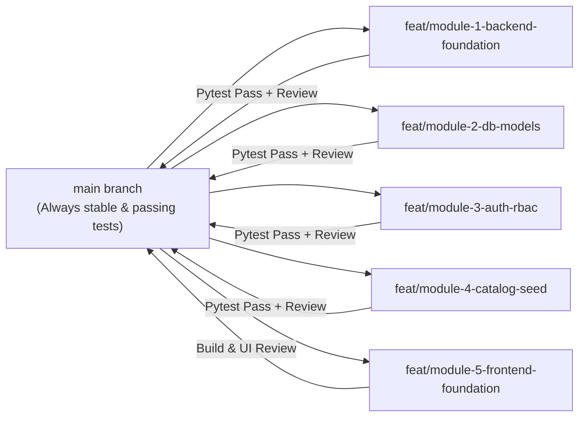

# GitHub Workflow & Engineering Discipline (Module 0)

Per **PRD Section 8.1**, **Section 11.2**, **Section 12.1 (`REQ-083`)**, and **Section 14.2 (`REQ-073`)**, the repository must exhibit a clean, incremental commit history across modules and maintain zero-tolerance protection against committing secrets.

---

## 1. Branching & Module Implementation Strategy



1. **`main` Branch Strategy:**
   - `main` represents the verified, working state of all completed modules (`Module 0` – `Module 15`).
   - Code is never pushed to `main` unless all automated tests for the current and prior modules pass `100%`.
2. **Module-by-Module Implementation Strategy (`Module 1` – `Module 15`):**
   - Each module is developed as a self-contained vertical increment, verified by its dedicated `test_module<N>_*.py` suite (and React build/UI verification from Module 5 onward), and tagged upon completion (`module-1-complete` through `module-15-complete`).
   - We stop at the end of every module to run the full regression test suite, review test/coverage outputs, and receive explicit user approval before starting the next module.

---

## 2. Conventional Commit Naming Convention (`REQ-083`)

Every module uses its designated Conventional Commit name:

| Module | Designated Git Commit Name |
| :--- | :--- |
| **Module 0** | `docs(module-0): establish project requirements, architecture, and 15-module roadmap` |
| **Module 1** | `feat(module-1): initialize FastAPI backend foundation, structured logging, and health check` |
| **Module 2** | `feat(module-2): configure PostgreSQL async session and SQLAlchemy relational models` |
| **Module 3** | `feat(module-3): implement JWT authentication, refresh token flow, and 4-role server-side RBAC` |
| **Module 4** | `feat(module-4): implement track acoustic profile API, admin upload validation, and catalog seed` |
| **Module 5** | `feat(module-5): scaffold React frontend foundation, auth flows, catalog browser, and admin upload UI` |
| **Module 6** | `feat(module-6): implement DJ Lounge creation, invite-code join flow, moderation controls, and lobby UI` |
| **Module 7** | `feat(module-7): implement 3-zone in-memory queue state machine, sparse positioning, and vote reordering` |
| **Module 8** | `feat(module-8): implement FastAPI WebSocket gateway, live queue sync, chat, presence, and batch persistence` |
| **Module 9** | `feat(module-9): implement deterministic BPM and 24-key Camelot wheel matcher with 50-30-20 ranking` |
| **Module 10** | `feat(module-10): implement RAG transition script generator, grounded Q&A with citations, and AI DJ UI` |
| **Module 11** | `feat(module-11): implement rolling-window chat sentiment engine, curation integration, and sentiment UI` |
| **Module 12** | `feat(module-12): implement Soundclash queue battles, real-time voting, queue splicing, and battle stage UI` |
| **Module 13** | `feat(module-13): implement hybrid recommendation engine, dynamic interaction updates, and Precision@5 evaluator` |
| **Module 14** | `feat(module-14): implement user dashboard, acoustic taste profile, and event-log reconciled session analytics` |
| **Module 15** | `test(module-15): complete multi-client sync drift benchmarks, Postman collection, and final evidence` |

---

## 3. Pre-Commit Verification & Testing Gate

Before creating any commit, the following checklist must pass:
1. **Regression Test Suite:** Run all unit and integration tests from Module $1 \dots k$ (`pytest` or `npm test`). Every existing test must remain green.
2. **Contract Verification:** Confirm that mandatory endpoints (`POST /api/v1/lounges`, `GET /api/v1/tracks/{trackId}/acoustic-profile`, `POST /api/v1/lounges/{id}/ai/segue`) and WebSocket envelopes (`{ event, loungeId, payload, ts }`) have not been altered.
3. **Secret Scan (`REQ-073`):** Run `git status` and `git diff --cached` to verify that `.env`, database credentials, JWT signing keys, or API keys are never staged.

---

## 4. Avoiding Regressions in Completed Modules

1. **Strict Module Boundaries (`REQ-050`):**
   - The **AI DJ Engine** (`services/aiDjEngine/`) is decoupled from the **WebSocket Queue Gateway** (`websocket/`) and **REST Controllers** (`controllers/`). Adding Module 4 (Sentiment & Soundclash) or Module 5 (Recommendations) calls clean service interfaces without rewriting Module 1 (Auth/Catalog) or Module 2 (WebSocket Core).
2. **Cumulative Automated Test Suite:**
   - Each module adds its own dedicated test file (e.g., `test_module1_auth_catalog`, `test_module2_ws_queue`, `test_module3_acoustic_rag`).
   - Running the test runner executes **all** prior modules' tests automatically before any new module is marked Done.

---

## 5. `.gitignore` & Zero-Tolerance Secrets Policy (`REQ-073`)

Per **PRD Section 10.1** and **Section 14.2**, committing credentials or secrets at any point in Git history is a zero-tolerance violation.

### Mandatory `.gitignore` Rules:
```gitignore
# Environment & Secrets (NEVER COMMIT)
.env
.env.*
!.env.example

# Dependencies & Virtual Environments
node_modules/
.venv/
venv/
__pycache__/
*.py[cod]

# Build, Coverage & Test Artifacts
dist/
build/
.pytest_cache/
coverage/
*.log

# Local Databases & OS Files
*.db
*.sqlite3
.DS_Store
Thumbs.db
```

### Secrets Protection Rules:
- Only `.env.example` (containing placeholder keys like `JWT_SECRET=replace_with_32_byte_random_secret`) may be tracked in Git.
- Application startup reads configuration strictly via `process.env` / `os.environ`.

---

## 6. GitHub Push & Rollback Strategy

### Push Procedure (End of Each Module):
1. Run full test suite and verify `0` failures.
2. Check `git status` and `git diff` to ensure only intended files are included and zero secrets exist.
3. Commit with `feat(module-N): ...` and `test(module-N): ...`.
4. Tag the module completion point (`git tag -a module-N-complete -m "Completed Module N"`).
5. Push branch and tags to remote (`git push origin main --tags`).

### Rollback Strategy:
- **Uncommitted Breaking Change:** `git checkout -- <file>` or `git restore .` to revert to the last passing state.
- **Committed Issue on Feature Branch:** `git revert <commit-sha>` (preferred to preserve history) or `git reset --soft module-<N-1>-complete` prior to pushing so that previous modules remain 100% intact.
