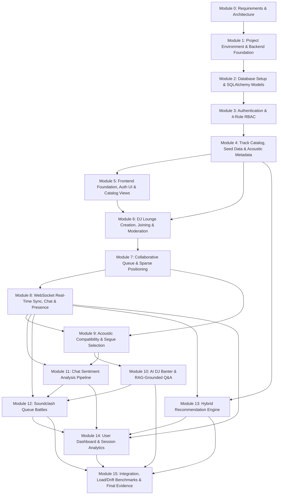

# Complete Module Breakdown & Roadmap (Final Module 0 — 15-Module Sequence)

## 1. Overview & Progressive Full-Stack Strategy

To ensure every milestone is small enough for a single engineer to implement, test, understand, review, and commit to GitHub independently (`REQ-083`), the **AI DJ Studio** project is structured into **Module 0** (Architecture & Specification) followed by **15 focused implementation modules (`Module 1` – `Module 15`)**.

### Confirmed Architecture, Track & Stack (`REQ-013`, `REQ-014`, `REQ-050`)
- **Architecture:** 5-Layer Modular Monolith (React Client, FastAPI REST Layer, FastAPI Native WebSocket Gateway, Logically Isolated AI DJ Engine Module, PostgreSQL Persistence + Static Audio Store).
- **Delivery Track:** **Track A — Full-Stack**
- **Technology Stack (PRD Section 8 — Option C):**
  - **Frontend:** React (JavaScript + Vite)
  - **Backend Framework:** Python FastAPI
  - **Real-Time Layer:** Native FastAPI WebSockets (`ConnectionManager` keyed by `loungeId`)
  - **Database:** PostgreSQL
  - **ORM / Data Access:** SQLAlchemy 2.0 (async with `asyncpg`)
  - **Auth & Authorization:** OAuth2 / JWT (`PyJWT` + `bcrypt`) with 4-Role server-side RBAC (`listener`, `co_dj`, `host`, `admin`)
  - **Testing:** Pytest (`pytest`, `pytest-asyncio`, `httpx`) + React component/build verification

### Dependency & Sequence Graph (Mermaid)

---

## 2. Detailed Module Specifications (`Module 0` – `Module 15`)

---

### Module 0 — Requirement Analysis & Project Architecture (Current Module)
- **Objective:** Extract 100% of requirements from the PRD, establish the traceability matrix, finalize the 5-layer modular monolith architecture, PostgreSQL database schema, REST/WebSocket contracts, 15-module roadmap, and GitHub workflow before writing any application code.
- **Exact Requirements Covered:** `REQ-013`, `REQ-014`, `REQ-018`, `REQ-050`, `REQ-083`, `REQ-085`, `REQ-086`, `REQ-087`, `REQ-095`
- **Prerequisites / Dependencies:** Original PRD (`0e1d3119ff014db328f80dad75feb8cb.docx`).
- **Backend Scope:** None (specification and architecture design only).
- **Frontend Scope:** None (specification and architecture design only).
- **Database Changes:** None (schema and ER diagram documented in `docs/DATABASE_DESIGN.md`).
- **Tests:** Manual completeness audit against all 15 sections of the PRD.
- **Acceptance Criteria:** All 95 requirements extracted with unique IDs (`REQ-001`–`REQ-095`) and mapped to `Module 0`–`Module 15`; mandatory API and WebSocket contracts preserved verbatim.
- **Files Expected to be Changed:**
  - `docs/PROJECT_REQUIREMENTS.md`
  - `docs/REQUIREMENT_TRACEABILITY.md`
  - `docs/ARCHITECTURE.md`
  - `docs/DATABASE_DESIGN.md`
  - `docs/MODULE_ROADMAP.md`
  - `docs/API_DESIGN.md`
  - `docs/TECH_STACK.md`
  - `docs/GITHUB_WORKFLOW.md`
- **Git Commit Name:** `docs(module-0): establish project requirements, architecture, and 15-module roadmap`
- **Definition of Done:** All 8 documentation files in `docs/` are complete, consistent, audited, and approved by the user.

---

### Module 1 — Project Environment & Backend Foundation
- **Objective:** Initialize the backend Python environment, project directory structure, environment variable loader (zero hardcoded secrets), structured JSON logging with Lounge correlation ID support, CORS middleware, error handling, and health-check endpoint (`GET /api/v1/health`).
- **Exact Requirements Covered:** `REQ-011`, `REQ-050`, `REQ-073`, `REQ-074`, `REQ-077`, `REQ-079`
- **Prerequisites / Dependencies:** Module 0 approval.
- **Backend Scope:**
  - Create FastAPI application factory (`backend/app/main.py`) and settings config via Pydantic BaseSettings / environment variables (`backend/app/core/config.py`).
  - Configure structured JSON logger (`backend/app/core/logging.py`) supporting `correlation_id` and `lounge_id`.
  - Implement `GET /api/v1/health` returning `{ status: "ok", service: "ai-dj-studio", version: "1.0.0" }`.
  - Configure `.gitignore` and `.env.example` so secrets are never committed.
- **Frontend Scope:** None (scaffolded in Module 5).
- **Database Changes:** None (configured in Module 2).
- **Tests:**
  - `backend/tests/test_module1_health_and_config.py`: Verify `GET /api/v1/health` returns HTTP `200` in `< 50 ms`, verify correlation ID header middleware, and verify secret settings load strictly from environment variables.
- **Acceptance Criteria:** FastAPI server boots cleanly; `GET /api/v1/health` responds with `200 OK`; structured logs include correlation IDs; `.gitignore` blocks `.env`.
- **Files Expected to be Changed:**
  - `.gitignore`, `.env.example`, `backend/requirements.txt`, `backend/pytest.ini`
  - `backend/app/__init__.py`, `backend/app/main.py`
  - `backend/app/core/config.py`, `backend/app/core/logging.py`, `backend/app/api/v1/health.py`
  - `backend/tests/test_module1_health_and_config.py`
- **Git Commit Name:** `feat(module-1): initialize FastAPI backend foundation, structured logging, and health check`
- **Definition of Done:** All Module 1 Pytest tests pass (`100%`), zero secrets staged, reviewed, and committed.

---

### Module 2 — Database Setup & SQLAlchemy Models
- **Objective:** Configure async SQLAlchemy 2.0 with PostgreSQL, define all 9 relational tables from PRD Section 7.2.2 (plus the append-only `queue_events` audit table), configure acoustic indexes and constraints, and wire database readiness into the health check.
- **Exact Requirements Covered:** `REQ-030`, `REQ-051`, `REQ-052`, `REQ-053`
- **Prerequisites / Dependencies:** Module 1.
- **Backend Scope:**
  - Configure SQLAlchemy async engine, connection pool, and `get_db` dependency (`backend/app/db/session.py`).
  - Implement SQLAlchemy ORM models (`backend/app/models/`) for all entities:
    1. `User` (`users`)
    2. `Track` (`tracks` with indexed `bpm`, `camelot_key`, `energy`, `valence`)
    3. `TrackTimelineEvent` (`track_timeline_events`)
    4. `DJLounge` (`dj_lounges`)
    5. `QueueEntry` (`queue_entries` with sparse integer `position`)
    6. `SoundclashBattle` (`soundclash_battles`)
    7. `SoundclashCandidate` (`soundclash_candidates`)
    8. `ChatMessage` (`chat_messages`) & `QueueEvent` (`queue_events`)
    9. `Interaction` (`interactions`)
  - Add schema initialization helper and update `GET /api/v1/health` to verify live database connectivity.
- **Frontend Scope:** None.
- **Database Changes:** Creation of all 10 relational tables, primary keys, foreign keys, check constraints (`role`, `camelot_key`, `energy`, `valence`, `status`), and acoustic composite index `idx_tracks_acoustic`.
- **Tests:**
  - `backend/tests/test_module2_database_models.py`: Verify table creation, CRUD operations across all models, foreign key integrity, and check constraints on `role`, `bpm > 0`, and `energy`/`valence ∈ [0.0, 1.0]`.
- **Acceptance Criteria:** All relational tables and indexes match PRD Section 7.2.2; database health check reports `db: "connected"`; model constraint tests pass.
- **Files Expected to be Changed:**
  - `backend/app/db/base.py`, `backend/app/db/session.py`
  - `backend/app/models/user.py`, `backend/app/models/track.py`, `backend/app/models/lounge.py`, `backend/app/models/queue.py`, `backend/app/models/soundclash.py`, `backend/app/models/chat.py`, `backend/app/models/interaction.py`
  - `backend/tests/test_module2_database_models.py`
- **Git Commit Name:** `feat(module-2): configure PostgreSQL async session and SQLAlchemy relational models`
- **Definition of Done:** All tables create cleanly, all Module 1–2 Pytest tests pass, reviewed, and committed.

---

### Module 3 — Authentication & 4-Role RBAC Authorization
- **Objective:** Implement user registration, login issuing short-lived JWT access tokens (`≤ 1 hour`), refresh-token exchange flow, password hashing (`bcrypt`), and server-side 4-role RBAC dependencies (`listener`, `co_dj`, `host`, `admin`).
- **Exact Requirements Covered:** `REQ-069`, `REQ-070`, `REQ-072`, `REQ-094`
- **Prerequisites / Dependencies:** Module 1, Module 2.
- **Backend Scope:**
  - Implement password hashing and JWT creation/verification utilities (`backend/app/core/security.py`) enforcing `access_token` expiry `≤ 3600 seconds` and `refresh_token` verification.
  - Implement FastAPI RBAC dependency guards (`require_roles(["admin"])`, `require_roles(["host", "admin"])`, `require_roles(["co_dj", "host", "admin"])`).
  - Implement Auth endpoints (`backend/app/api/v1/auth.py`):
    - `POST /api/v1/auth/register`
    - `POST /api/v1/auth/login`
    - `POST /api/v1/auth/refresh`
    - `GET /api/v1/auth/me`
- **Frontend Scope:** None (Auth UI is implemented in Module 5).
- **Database Changes:** Active reads/writes on `users` table.
- **Tests:**
  - `backend/tests/test_module3_auth_and_rbac.py`: Test user registration, duplicate email rejection (`409`), login token issuance (`exp <= 3600s`), token refresh flow, invalid/expired token rejection (`401`), and server-side RBAC rejection (`403 Forbidden`) across all 4 roles (`listener`, `co_dj`, `host`, `admin`) (`REQ-094`).
- **Acceptance Criteria:** Access JWTs expire in `≤ 1 hour`; refresh endpoint issues new access tokens; unauthorized role attempts against protected routes are rejected server-side with `403 Forbidden`.
- **Files Expected to be Changed:**
  - `backend/app/core/security.py`, `backend/app/schemas/auth.py`, `backend/app/api/deps.py`, `backend/app/api/v1/auth.py`
  - `backend/tests/test_module3_auth_and_rbac.py`
- **Git Commit Name:** `feat(module-3): implement JWT authentication, refresh token flow, and 4-role server-side RBAC`
- **Definition of Done:** All Module 1–3 tests pass (including 4-role RBAC rejection proof), reviewed, and committed.

---

### Module 4 — Track Catalog, Seed Data & Acoustic Metadata Upload
- **Objective:** Implement the mandatory `GET /api/v1/tracks/{trackId}/acoustic-profile` endpoint (PRD Section 7.3.2), catalog listing (`GET /api/v1/tracks`), Admin-only acoustic profile upload and validation endpoint (`POST /api/v1/admin/tracks`), and a deterministic seed script generating 4 test users and 10 royalty-free tracks (with synthesized `.wav` audio assets and rich RAG metadata timelines forming valid harmonic segue chains).
- **Exact Requirements Covered:** `REQ-004`, `REQ-012`, `REQ-034`, `REQ-046`, `REQ-049`, `REQ-058`, `REQ-080`
- **Prerequisites / Dependencies:** Module 2, Module 3.
- **Backend Scope:**
  - Implement Pydantic validation schemas for Track and Acoustic Profile (`backend/app/schemas/track.py`) strictly validating `bpm > 0`, 24 valid Camelot key codes (`1A`–`12A`, `1B`–`12B`), `energy ∈ [0.0, 1.0]`, `valence ∈ [0.0, 1.0]`, and timeline event types (`sample_credit`, `trivia`, `glossary`).
  - Implement `GET /api/v1/tracks/{trackId}/acoustic-profile` returning the exact JSON contract in PRD Section 7.3.2 (`REQ-058`).
  - Implement `GET /api/v1/tracks` and Admin-only `POST /api/v1/admin/tracks` (`REQ-046`, `REQ-049`).
  - Mount static audio asset serving (`/assets/audio/*`) and create `backend/app/seeds/seed_data.py` populating 4 role accounts and 10 royalty-free tracks (`t_2001`–`t_2010`) with generated `.wav` audio files and timeline events (`evt_5541`, etc.).
- **Frontend Scope:** None (connected in Module 5).
- **Database Changes:** Seed population of `users`, `tracks`, and `track_timeline_events`.
- **Tests:**
  - `backend/tests/test_module4_tracks_and_seed.py`: Verify exact PRD Section 7.3.2 response contract for `GET /api/v1/tracks/t_2001/acoustic-profile`; verify Admin upload succeeds for `admin` (`201`) and fails with `403` for `listener`/`co_dj`/`host`; verify `400 Bad Request` on invalid BPM (`-5`, `0`), invalid Camelot key (`13A`, `8C`), or invalid energy (`1.5`) (`REQ-049`).
- **Acceptance Criteria:** Seed script runs idempotently; `GET /api/v1/tracks/{trackId}/acoustic-profile` matches Section 7.3.2 verbatim; Admin upload validation rejects all invalid acoustic inputs with clear errors.
- **Files Expected to be Changed:**
  - `backend/app/schemas/track.py`, `backend/app/api/v1/tracks.py`, `backend/app/seeds/seed_data.py`, `backend/assets/audio/*.wav`
  - `backend/tests/test_module4_tracks_and_seed.py`
- **Git Commit Name:** `feat(module-4): implement track acoustic profile API, admin upload validation, and catalog seed`
- **Definition of Done:** Seed script populates 10 tracks and 4 users, audio assets are served, all Module 1–4 tests pass, reviewed, and committed.

---

### Module 5 — Frontend Foundation, Auth UI & Catalog/Admin Views
- **Objective:** Scaffold the Track A React application early so every subsequent backend module can be integrated and verified visually alongside automated tests. Implement API client with automatic JWT refresh interceptor, Auth Context, Login/Register UI, Role Navigation Shell, Track Catalog Browser with audio preview, and the Admin Acoustic Profile Upload UI.
- **Exact Requirements Covered:** `REQ-002`, `REQ-003`, `REQ-046`, `REQ-049`
- **Prerequisites / Dependencies:** Module 3, Module 4.
- **Backend Scope:** Verify CORS configuration for the Vite React dev server (`http://localhost:5173`).
- **Frontend Scope:**
  - Initialize React + Vite project in `frontend/`.
  - Build `frontend/src/api/httpClient.js` attaching Bearer JWT and automatically calling `POST /api/v1/auth/refresh` on `401`.
  - Build `AuthContext` (`login`, `register`, `logout`, demo quick-role switcher for `Listener`, `Co-DJ`, `Host`, `Admin`).
  - Build `LoginPage`, `CatalogPage` (displaying tracks, BPM, Camelot key badges, energy/valence bars, and RAG timeline metadata modal), and `AdminUploadPage` (validated form for uploading track acoustic profiles and timeline events).
- **Database Changes:** None.
- **Tests:**
  - `frontend` production build verification (`npm run build`) and automated component/API integration check.
- **Acceptance Criteria:** Users can log in/register in the React UI, inspect seeded tracks and their acoustic profiles, play local royalty-free audio previews, and (when logged in as `Admin`) upload a new track profile through the form.
- **Files Expected to be Changed:**
  - `frontend/package.json`, `frontend/vite.config.js`, `frontend/index.html`
  - `frontend/src/App.jsx`, `frontend/src/main.jsx`, `frontend/src/api/httpClient.js`, `frontend/src/context/AuthContext.jsx`
  - `frontend/src/pages/LoginPage.jsx`, `frontend/src/pages/CatalogPage.jsx`, `frontend/src/pages/AdminUploadPage.jsx`
- **Git Commit Name:** `feat(module-5): scaffold React frontend foundation, auth flows, catalog browser, and admin upload UI`
- **Definition of Done:** Frontend builds cleanly with zero warnings/errors, connects to Module 1–4 APIs, verified end-to-end, and committed.

---

### Module 6 — DJ Lounge Creation, Joining & Host Moderation
- **Objective:** Implement DJ Lounge creation (`POST /api/v1/lounges` matching PRD Section 7.3.1 verbatim), invite-code lookup and joining (`POST /api/v1/lounges/join/{inviteCode}`) with capacity limits (`maxParticipants`, up to 50), lifecycle controls (`start`, `end`), Host moderation controls (`mute`, `remove`, `lock`, `set_role`), and the corresponding Lounge Creation & Lobby UI in React.
- **Exact Requirements Covered:** `REQ-007`, `REQ-015`, `REQ-016`, `REQ-019`, `REQ-025`, `REQ-057`, `REQ-076`
- **Prerequisites / Dependencies:** Module 4, Module 5.
- **Backend Scope:**
  - Implement mandatory `POST /api/v1/lounges` returning HTTP `201` with `{ loungeId, inviteCode, status, hostUserId, createdAt }` (`REQ-057`).
  - Implement `GET /api/v1/lounges`, `GET /api/v1/lounges/{id}`, `POST /api/v1/lounges/join/{inviteCode}`, `POST /api/v1/lounges/{id}/start`, `POST /api/v1/lounges/{id}/end`, and `POST /api/v1/lounges/{id}/moderation`.
  - Enforce room capacity limits (`409 Conflict` when full), room lock (`403 Forbidden`), and Host-only RBAC on moderation and room lifecycle actions.
- **Frontend Scope:**
  - Add **Create DJ Lounge Modal** (selecting `seedTrackId`, `vibeProfile`, `maxParticipants`, `bpmTolerancePct`, `soundclashEnabled`, `aiVerbosity`), **Join via Invite Code Bar** (`SP-9X2L`), and **Lounge War Room Shell** with Host Moderation Toolbar.
- **Database Changes:** Active reads/writes on `dj_lounges` and initial `queue_entries`.
- **Tests:**
  - `backend/tests/test_module6_lounge_lifecycle.py`: Verify exact PRD Section 7.3.1 contract for `POST /api/v1/lounges`; test joining via `inviteCode`; test capacity limit rejection; test Host moderation actions (`mute`, `remove`, `lock`, `set_role`) and `403` rejection when called by a `listener`.
- **Acceptance Criteria:** `POST /api/v1/lounges` matches Section 7.3.1 verbatim; invite code joins enforce capacity and lock states; Host moderation controls are enforced server-side and accessible in the UI.
- **Files Expected to be Changed:**
  - `backend/app/schemas/lounge.py`, `backend/app/services/lounge_service.py`, `backend/app/api/v1/lounges.py`
  - `frontend/src/pages/LoungeLobbyPage.jsx`, `frontend/src/pages/LoungeWarRoomPage.jsx`, `frontend/src/components/lounge/HostModerationBar.jsx`
  - `backend/tests/test_module6_lounge_lifecycle.py`
- **Git Commit Name:** `feat(module-6): implement DJ Lounge creation, invite-code join flow, moderation controls, and lobby UI`
- **Definition of Done:** All Module 1–6 backend tests and frontend build pass, reviewed, and committed.

---

### Module 7 — Collaborative Queue Management & Sparse Positioning
- **Objective:** Implement the authoritative 3-zone in-memory Queue State Machine (`Now Playing`, `Next Up`, `Soundclash Stage`) keyed by `loungeId`, sparse integer queue positioning (`1000, 2000, 3000...` per PRD Section 7.2.2), vote-driven deterministic queue reordering, Host/Co-DJ manual queue overrides, and the interactive `Now Playing` / `Next Up` Queue UI components.
- **Exact Requirements Covered:** `REQ-020`, `REQ-021`, `REQ-027`, `REQ-054`, `REQ-055`
- **Prerequisites / Dependencies:** Module 6.
- **Backend Scope:**
  - Build `RoomStateManager` (`backend/app/services/room_state_manager.py`) holding per-lounge authoritative state in memory with an `asyncio.Lock` per `loungeId` to serialize concurrent mutations deterministically (`REQ-027`, `REQ-055`).
  - Implement sparse integer positioning (`1000, 2000, 3000...`) so promoting or reordering a single track updates its position to the midpoint $\lfloor(A+B)/2\rfloor$ without renumbering the entire queue (`REQ-054`).
  - Implement queue endpoints: `POST /api/v1/lounges/{id}/queue` (add track), `POST /api/v1/lounges/{id}/queue/vote` (upvote & atomic re-sort), and `POST /api/v1/lounges/{id}/queue/override` (`co_dj`/`host`/`admin` promote, remove, or advance track).
- **Frontend Scope:**
  - Build `NowPlayingDeck.jsx` and `NextUpQueue.jsx` inside `LoungeWarRoomPage.jsx` displaying sparse positions, vote counts, one-click Upvote buttons, Add Track drawer, and Host/Co-DJ promote/remove buttons.
- **Database Changes:** Syncs queue state with `queue_entries`.
- **Tests:**
  - `backend/tests/test_module7_queue_state_machine.py`: Unit and integration tests for 3-zone queue state transitions, sparse integer midpoint calculation, and concurrent vote determinism (`asyncio.gather` of simultaneous votes on different tracks producing 100% consistent ordering) (`REQ-027`).
- **Acceptance Criteria:** Queue state machine manages `Now Playing`, `Next Up`, and `Soundclash Stage` in memory; sparse integer positioning avoids full-table renumbering; concurrent votes never produce state divergence.
- **Files Expected to be Changed:**
  - `backend/app/services/room_state_manager.py`, `backend/app/api/v1/queue.py`
  - `frontend/src/components/lounge/NowPlayingDeck.jsx`, `frontend/src/components/lounge/NextUpQueue.jsx`
  - `backend/tests/test_module7_queue_state_machine.py`
- **Git Commit Name:** `feat(module-7): implement 3-zone in-memory queue state machine, sparse positioning, and vote reordering`
- **Definition of Done:** All Module 1–7 tests pass (including concurrent vote determinism test), UI queue interaction verified, reviewed, and committed.

---

### Module 8 — WebSocket Real-Time Synchronization, Chat & Presence
- **Objective:** Implement the FastAPI Native WebSocket Queue & State Gateway (`/ws/lounges/{loungeId}?token=<JWT>`) enforcing the exact PRD Section 7.3.4 envelope (`{ event, loungeId, payload, ts }`), sub-100ms atomic queue broadcast (`lounge.queue.update`), mid-session join snapshot (`< 2s`), live chat (`lounge.chat.message` with XSS sanitization, typing indicators, emoji reactions), presence (`lounge.presence.update`), latency ping/pong (`lounge.sync.ping`/`pong`), reconnect grace window (`30s`), deterministic Host disconnect handling, and batched DB event persistence (`1.5s` interval).
- **Exact Requirements Covered:** `REQ-005`, `REQ-023`, `REQ-024`, `REQ-026`, `REQ-028`, `REQ-029`, `REQ-056`, `REQ-060`, `REQ-061`, `REQ-062`, `REQ-063`, `REQ-068`, `REQ-071`, `REQ-075`, `REQ-078`, `REQ-089`
- **Prerequisites / Dependencies:** Module 7.
- **Backend Scope:**
  - Implement `WebSocketConnectionManager` and `/ws/lounges/{loungeId}` endpoint (`backend/app/websocket/gateway.py`) with JWT handshake validation (`REQ-071`).
  - Emit full state snapshot (`lounge.state.snapshot`) within `< 2s` of client join (`REQ-028`).
  - Broadcast `lounge.queue.update`, `lounge.presence.update`, `lounge.chat.message` (with HTML/XSS sanitization), and handle `lounge.sync.ping` $\rightarrow$ `lounge.sync.pong` (`REQ-060`–`REQ-063`, `REQ-068`).
  - Implement `30s` reconnect grace window suppressing duplicate `joined` presence events (`REQ-078`) and deterministic Host disconnect handling (`lounge.host.status` promoting active `co_dj` or freezing mutations until Host reconnects per `REQ-029`).
  - Implement `BatchPersistenceWorker` (`backend/app/websocket/batch_persistence.py`) flushing queued `chat_messages` and `queue_events` every `1.5 seconds` or `50` events (`REQ-056`).
- **Frontend Scope:**
  - Implement `useLoungeSocket.js` hook managing WebSocket connection, auto-reconnect, and periodic `lounge.sync.ping` RTT measurement.
  - Build `LiveChatPanel.jsx` (messages, typing indicators, emoji reactions) and `PresenceHeader.jsx` (participant count, latency indicator, Host disconnect banner).
- **Database Changes:** Batched bulk inserts into `chat_messages` and `queue_events`.
- **Tests:**
  - `backend/tests/test_module8_websocket_gateway.py`: Test WS JWT handshake rejection for invalid tokens; test `< 100 ms` multi-client sync on vote reorder (`REQ-026`); test `< 2s` mid-session join snapshot (`REQ-028`); test Host disconnect promotion/freeze (`REQ-029`); test reconnect within grace window without duplicate `joined` event (`REQ-078`); test XSS sanitization in chat (`REQ-072`).
- **Acceptance Criteria:** Two or more connected sessions see vote reorders and chat messages within `< 100 ms`; mid-session join syncs in `< 2s`; Host disconnect behavior is deterministic and tested.
- **Files Expected to be Changed:**
  - `backend/app/websocket/gateway.py`, `backend/app/websocket/batch_persistence.py`
  - `frontend/src/hooks/useLoungeSocket.js`, `frontend/src/components/chat/LiveChatPanel.jsx`, `frontend/src/components/lounge/PresenceHeader.jsx`
  - `backend/tests/test_module8_websocket_gateway.py`
- **Git Commit Name:** `feat(module-8): implement FastAPI WebSocket gateway, live queue sync, chat, presence, and batch persistence`
- **Definition of Done:** All Module 1–8 tests pass, two browser tabs synchronize queue votes and chat live in `< 100 ms`, reviewed, and committed.

---

### Module 9 — Acoustic Compatibility Matcher & Segue Selection
- **Objective:** Implement the deterministic Acoustic Feature Matcher enforcing the hard BPM compatibility rule (`±8%` or custom `bpmTolerancePct`, plus `×0.5` half-time and `×2.0` double-time multiples) and the hard 24-key Camelot Wheel compatibility rule (`identical`, `±1` circular adjacent on same letter `1↔12`, or `same number opposite letter A↔B`), plus the `50% Harmonic / 30% Energy-Curve Fit / 20% Recency` candidate ranking formula.
- **Exact Requirements Covered:** `REQ-009`, `REQ-031`, `REQ-032`, `REQ-033`, `REQ-039`
- **Prerequisites / Dependencies:** Module 4, Module 7, Module 8.
- **Backend Scope:**
  - Implement `AcousticMatcher` (`backend/app/services/ai_dj/acoustic_matcher.py`):
    - `check_bpm_compatibility(current_bpm, candidate_bpm, tolerance_pct=8.0)` supporting `1.0x`, `0.5x`, and `2.0x` multiples.
    - `check_camelot_compatibility(current_key, candidate_key)` supporting `exact`, `adjacent` (including `1A <-> 12A` and `1B <-> 12B` circular wrap-around), and `relative` (`8A <-> 8B`).
    - `rank_candidates(current_track, candidates, current_sentiment_score, recent_track_ids, tolerance_pct)` applying the exact `0.50 * harmonic + 0.30 * energy_fit + 0.20 * recency` weighted score.
- **Frontend Scope:**
  - Display **Harmonic Match Badges** (`Exact Key`, `Adjacent Key`, `Relative Major/Minor`, `BPM Δ%`) on queued tracks in `NextUpQueue.jsx`.
- **Database Changes:** None.
- **Tests:**
  - `backend/tests/test_module9_acoustic_matcher.py`: Exhaustive unit tests covering all `24 × 24 = 576` Camelot key pairs, normal/half-time/double-time BPM windows, `50/30/20` ranking order, and an automated simulation asserting `100%` rule compliance across `≥ 25` varied segue decisions (`REQ-009`, `REQ-039`).
- **Acceptance Criteria:** `100%` of selected segues satisfy both BPM and Camelot rules; invalid candidates are strictly disqualified; automated test over `≥ 20` simulated segue decisions passes `100%`.
- **Files Expected to be Changed:**
  - `backend/app/services/ai_dj/acoustic_matcher.py`
  - `frontend/src/components/lounge/MatchReasonBadge.jsx`, `frontend/src/components/lounge/NextUpQueue.jsx`
  - `backend/tests/test_module9_acoustic_matcher.py`
- **Git Commit Name:** `feat(module-9): implement deterministic BPM and 24-key Camelot wheel matcher with 50-30-20 ranking`
- **Definition of Done:** All 25+ simulated segue decisions and 576 Camelot pair tests pass 100%, UI displays compatibility badges, reviewed, and committed.

---

### Module 10 — AI DJ Transition Banter & RAG-Grounded Q&A
- **Objective:** Implement the RAG-grounded Transition Script Generator and Conversational Track Lore Q&A service (`< 3 seconds P95`), expose the mandatory `POST /api/v1/lounges/{id}/ai/segue` endpoint (PRD Section 7.3.3 verbatim) and `POST /api/v1/lounges/{id}/ai/qa`, broadcast `lounge.ai.dj_announcement`, and build the AI DJ Banter Feed & RAG Q&A Drawer in React.
- **Exact Requirements Covered:** `REQ-006`, `REQ-017`, `REQ-036`, `REQ-037`, `REQ-040`, `REQ-059`, `REQ-067`, `REQ-090`
- **Prerequisites / Dependencies:** Module 8, Module 9.
- **Backend Scope:**
  - Implement `RAGStoryteller` (`backend/app/services/ai_dj/rag_generator.py`) retrieving `track_timeline_events` for the active/selected track, generating transition scripts and Q&A answers via configured LLM API (with a `1.8s` timeout + deterministic metadata-grounded fallback), and enforcing machine-readable `sourceEvents` citations (`["evt_5541"]`) without fabricating facts (`REQ-036`, `REQ-037`, `REQ-040`).
  - Implement mandatory `POST /api/v1/lounges/{id}/ai/segue` matching PRD Section 7.3.3 verbatim (`REQ-059`) and broadcasting `lounge.ai.dj_announcement` + `lounge.queue.update` (`reason: 'segue'`) (`REQ-067`).
  - Implement `POST /api/v1/lounges/{id}/ai/qa` for listener natural-language questions.
- **Frontend Scope:**
  - Build `TransitionBanterFeed.jsx` and `RagQaDrawer.jsx` inside `LoungeWarRoomPage.jsx` displaying live AI DJ transition scripts, acoustic `matchReason` breakdown, clickable `sourceEvents` citation pills, outro segue trigger button, and interactive listener Q&A input.
- **Database Changes:** Persists `dj_announcement` and `ai_answer` records with `source_events` in `chat_messages` and `segue` events in `queue_events`.
- **Tests:**
  - `backend/tests/test_module10_ai_segue_and_rag.py`: Verify exact PRD Section 7.3.3 response contract for `POST /api/v1/lounges/{id}/ai/segue`; verify P95 latency `< 3 seconds` (`REQ-006`); verify every transition script and Q&A response includes accurate `sourceEvents` citations and refuses to fabricate facts when asked about unindexed topics (`REQ-040`).
- **Acceptance Criteria:** `POST /api/v1/lounges/{id}/ai/segue` matches Section 7.3.3 verbatim; P95 latency `< 3s`; RAG Q&A cites `sourceEvents` and never hallucinates; `lounge.ai.dj_announcement` updates all connected clients live.
- **Files Expected to be Changed:**
  - `backend/app/services/ai_dj/rag_generator.py`, `backend/app/api/v1/ai_dj.py`
  - `frontend/src/components/aidj/TransitionBanterFeed.jsx`, `frontend/src/components/aidj/RagQaDrawer.jsx`
  - `backend/tests/test_module10_ai_segue_and_rag.py`
- **Git Commit Name:** `feat(module-10): implement RAG transition script generator, grounded Q&A with citations, and AI DJ UI`
- **Definition of Done:** All Module 1–10 tests pass, AI segue and grounded Q&A work live in UI and API, reviewed, and committed.

---

### Module 11 — Live Chat Sentiment Analysis Pipeline
- **Objective:** Implement the Live Chat Sentiment Classifier (`positive` / `neutral` / `negative` energy bucketing achieving `≥ 85%` accuracy on a manually labeled test dataset) and the Rolling-Window Sentiment Aggregator that continuously computes the room's `rollingScore`, broadcasts `lounge.sentiment.score`, visibly reacts within `1 aggregation window` to chat tone shifts, and feeds into the AI DJ's queue curation and candidate ranking.
- **Exact Requirements Covered:** `REQ-008`, `REQ-035`, `REQ-041`, `REQ-064`, `REQ-092`
- **Prerequisites / Dependencies:** Module 8, Module 9, Module 10.
- **Backend Scope:**
  - Implement `SentimentEngine` (`backend/app/services/ai_dj/sentiment_engine.py`) classifying chat text and emojis into `positive`, `neutral`, or `negative` energy and computing the rolling-window score (`windowSeconds = 60`).
  - Integrate `SentimentEngine` into the WebSocket chat pipeline so every `lounge.chat.message` carries its accurate `sentimentBucket`, updates the Lounge's rolling window, emits `lounge.sentiment.score` `{ rollingScore, windowSeconds, sampleSize }` (`REQ-064`), and triggers sentiment-aware queue curation (`REQ-035`).
- **Frontend Scope:**
  - Build `SentimentMeter.jsx` (animated live room energy gauge + trend indicator) and per-message sentiment badges (`positive`/`neutral`/`negative`) inside `LiveChatPanel.jsx`.
- **Database Changes:** Populates `sentiment_score` and `sentiment_bucket` on `chat_messages` and logs `sentimentTick` events in `queue_events`.
- **Tests:**
  - `backend/tests/test_module11_sentiment_engine.py`:
    1. Evaluate classifier against a manually labeled test set of `50` realistic DJ lounge chat messages (hype, praise, neutral questions, boredom/fatigue, negative complaints, emojis), asserting `≥ 85%` accuracy (`REQ-008`).
    2. Integration test sending a burst of negative/positive chat messages over WebSocket and verifying `lounge.sentiment.score` visibly shifts within `1 aggregation window` and alters AI DJ candidate selection toward matching energy (`REQ-041`, `REQ-092`).
- **Acceptance Criteria:** Sentiment classification accuracy `≥ 85%` on labeled test set; room `rollingScore` shifts within 1 aggregation window of a chat burst and influences queue curation; UI sentiment meter updates live.
- **Files Expected to be Changed:**
  - `backend/app/services/ai_dj/sentiment_engine.py`, `backend/app/websocket/gateway.py`
  - `frontend/src/components/chat/SentimentMeter.jsx`, `frontend/src/components/chat/LiveChatPanel.jsx`
  - `backend/tests/test_module11_sentiment_engine.py`
- **Git Commit Name:** `feat(module-11): implement rolling-window chat sentiment engine, curation integration, and sentiment UI`
- **Definition of Done:** Accuracy test achieves `≥ 85%`, single-window shift test passes, live UI sentiment gauge works, reviewed, and committed.

---

### Module 12 — Soundclash Queue Battles
- **Objective:** Implement end-to-end crowd **Soundclash Battles**: challenger track submission, Host/Co-DJ/AI DJ opening a timed battle (`2–4` candidates, broadcasting `lounge.soundclash.open`), real-time listener voting, automatic timer or manual resolution (broadcasting `lounge.soundclash.resolved`), atomic splicing of the winning track into the `Next Up` queue (`lounge.queue.update` with `reason: 'battle'`), AI DJ winner banter announcement (`lounge.ai.dj_announcement`), and the interactive `SoundclashStage.jsx` UI.
- **Exact Requirements Covered:** `REQ-022`, `REQ-038`, `REQ-042`, `REQ-065`, `REQ-066`, `REQ-091`
- **Prerequisites / Dependencies:** Module 8, Module 10, Module 11.
- **Backend Scope:**
  - Implement `SoundclashService` (`backend/app/services/ai_dj/soundclash_resolver.py`) managing candidate submissions, timed battle countdowns, per-user vote deduplication, tie-break logic, atomic queue splicing at the top of `Next Up`, and RAG-grounded winner announcement banter.
  - Implement Soundclash REST endpoints (`/api/v1/lounges/{id}/soundclash/*`) and WebSocket vote handlers emitting `lounge.soundclash.open` (`REQ-065`), `lounge.soundclash.resolved` (`REQ-066`), `lounge.queue.update` (`reason: 'battle'`), and `lounge.ai.dj_announcement`.
- **Frontend Scope:**
  - Build `SoundclashStage.jsx` inside `LoungeWarRoomPage.jsx` with challenger submission modal, live countdown timer, side-by-side candidate cards (`2–4`), animated vote bars, one-click Listener vote buttons, and Host/Co-DJ Open/Resolve controls.
- **Database Changes:** Active reads/writes on `soundclash_battles`, `soundclash_candidates`, `queue_entries`, and `queue_events` (`battleResolved`).
- **Tests:**
  - `backend/tests/test_module12_soundclash_battles.py`: End-to-end multi-client test covering candidate submission (`2–4` tracks), `lounge.soundclash.open` broadcast, concurrent listener voting, battle resolution, simultaneous receipt of `lounge.soundclash.resolved` across all connected clients, verification that `winningTrackId` is spliced into `Next Up` slot 1 (`REQ-042`, `REQ-091`), and verification that a `listener` token cannot force-resolve a battle (`403`).
- **Acceptance Criteria:** Soundclash battles open for 2–4 candidates, tally votes live, resolve deterministically, splice the winner into `Next Up`, announce via AI DJ banter, and reflect identically on all clients within `< 100 ms`.
- **Files Expected to be Changed:**
  - `backend/app/services/ai_dj/soundclash_resolver.py`, `backend/app/api/v1/soundclash.py`
  - `frontend/src/components/lounge/SoundclashStage.jsx`
  - `backend/tests/test_module12_soundclash_battles.py`
- **Git Commit Name:** `feat(module-12): implement Soundclash queue battles, real-time voting, queue splicing, and battle stage UI`
- **Definition of Done:** All Module 1–12 tests pass, full Soundclash battle works live across two browser tabs, reviewed, and committed.

---

### Module 13 — Hybrid Recommendation Engine (Independent of Dashboard)
- **Objective:** Implement and evaluate the **Hybrid Recommendation Engine** (Content-Based acoustic vector similarity + Collaborative Filtering co-listening affinity) independently of the dashboard, expose interaction ingestion (`POST /api/v1/interactions`) and recommendation serving (`GET /api/v1/recommendations`), support cold-start users and tracks, update recommendations dynamically when new interactions are recorded, and verify `Precision@5 ≥ 0.60` using a strict, non-fabricated offline train/test evaluation harness.
- **Exact Requirements Covered:** `REQ-010`, `REQ-044`, `REQ-047`
- **Prerequisites / Dependencies:** Module 4 (Track Catalog & Acoustic Vectors), Module 8 (Lounge Co-Listening Presence).
- **Backend Scope:**
  1. **Interaction Ingestion (`POST /api/v1/interactions`):** Records `user_id`, `track_id`, `lounge_id`, `played_seconds`, `completed`, `liked`, and `co_listened_with` (peer `user_id`s present in the Lounge).
  2. **Hybrid Scoring Architecture (`backend/app/services/recommendation/hybrid_recommender.py`):**
     - **Content-Based Branch ($S_{\text{content}}$):** Encodes each track as a 5D normalized acoustic feature vector $\mathbf{v}_t = [\text{BPM}_{\text{norm}}, \sin(2\pi k/12), \cos(2\pi k/12), \text{energy}, \text{valence}]$. Builds user $u$'s **Acoustic Taste Profile Vector** $\mathbf{p}_u$ as the interaction-weighted mean of tracks consumed in user $u$'s training history (weight $w = 2.0$ if `liked`, $1.5$ if `completed`, $0.2$ if skipped early). Computes cosine similarity $\cos(\mathbf{p}_u, \mathbf{v}_t)$.
     - **Collaborative Filtering Branch ($S_{\text{collab}}$):** Builds a user-user co-listening and preference affinity matrix $W_{u,v}$ from shared Lounge sessions (`co_listened_with`) and overlapping positive track interactions in the training split, predicting user $u$'s affinity for candidate track $t$ from peer ratings.
     - **Hybrid Blending & Cold-Start Handling:**
       - *Standard User & Track:* $\text{Score}(u, t) = \alpha \cdot S_{\text{content}}(u, t) + (1 - \alpha) \cdot S_{\text{collab}}(u, t)$ with $\alpha = 0.55$.
       - *User Cold-Start (0 prior training interactions):* Uses the acoustic centroid of the user's declared `preferences.genreAffinity` (or active Lounge `vibeProfile`) blended with global catalog completion/like rate.
       - *Track Cold-Start (newly uploaded track with 0 interactions):* Sets $\alpha = 1.0$ (pure Content-Based acoustic similarity) so newly uploaded Admin tracks are immediately recommendable without waiting for collaborative logs.
  3. **Rigorous Offline `Precision@5` Evaluation Methodology (`backend/app/services/recommendation/evaluator.py`):**
     - **Ground-Truth Relevance Definition:** A held-out interaction $(u, t)$ is defined as ground-truth **Relevant** ($\text{rel}(u, t) = 1$) if and only if `liked == True` OR (`completed == True` AND `played_seconds >= 0.80 * track.duration_seconds`). Early skips (`completed == False` and `liked == False`) are strictly **Non-Relevant** ($\text{rel}(u, t) = 0$).
     - **Chronological Train/Test Separation (Zero Data Leakage):** For every evaluated user $u$, interactions are sorted chronologically by `created_at`. The earliest `70%` of interactions are assigned to `D_train` and the latest `30%` are held out in `D_test`. The recommender fits user taste profiles and collaborative matrices **exclusively on `D_train`**. During evaluation, tracks already consumed in `D_train(u)` are excluded from candidate ranking so the model is tested strictly on unseen track discovery.
     - **Metric Computation & Transparent Reporting:**
       $$\text{Precision@5}(u) = \frac{|\text{Top}_5(u) \cap \{t \in D_{\text{test}}(u) : \text{rel}(u, t) = 1\}|}{5}, \quad \text{Mean Precision@5} = \frac{1}{|U_{\text{eval}}|} \sum_{u \in U_{\text{eval}}} \text{Precision@5}(u)$$
       The evaluator outputs a transparent diagnostic report (`Mean Precision@5`, per-user breakdown, content-only baseline, collaborative-only baseline, hybrid score, and train/test counts) without hardcoding or fabricating pass results.
- **Frontend Scope:**
  - Build standalone `RecommendationRail.jsx` component (rendered in the catalog/dashboard view) displaying the ranked `"Recommended for You"` tracks, hybrid match percentage, explanation badge (`"Matches your 8A / 124 BPM taste & co-listeners"`), and Like/Play interaction triggers.
- **Database Changes:** Populates and queries `interactions` table (`user_id`, `track_id`, `played_seconds`, `completed`, `liked`, `co_listened_with`, `created_at`).
- **Tests:**
  - `backend/tests/test_module13_hybrid_recommender.py`:
    1. Verify strict chronological train/test split (`D_train` vs `D_test` has zero leakage) and verify ground-truth relevance labeling.
    2. Run offline evaluation and assert `Mean Precision@5 ≥ 0.60` (`REQ-010`).
    3. Test User Cold-Start (brand-new user with 0 interactions) and Track Cold-Start (newly uploaded track with 0 interactions).
    4. Test dynamic update: recording a new `POST /api/v1/interactions` event immediately shifts the user's subsequent `GET /api/v1/recommendations` ranking without a model redeploy (`REQ-047`).
- **Acceptance Criteria:** Recommender runs and is tested independently of the dashboard; chronological train/test split has zero leakage; `Mean Precision@5 ≥ 0.60`; cold-start cases work cleanly; new interactions dynamically update recommendations.
- **Files Expected to be Changed:**
  - `backend/app/schemas/recommendation.py`, `backend/app/services/recommendation/hybrid_recommender.py`, `backend/app/services/recommendation/evaluator.py`, `backend/app/api/v1/recommendations.py`
  - `frontend/src/components/dashboard/RecommendationRail.jsx`
  - `backend/tests/test_module13_hybrid_recommender.py`
- **Git Commit Name:** `feat(module-13): implement hybrid recommendation engine, dynamic interaction updates, and Precision@5 evaluator`
- **Definition of Done:** All Module 1–13 tests pass (including `Precision@5 ≥ 0.60`, cold-start, and dynamic update tests), reviewed, and committed.

---

### Module 14 — User Dashboard & Session Analytics (With Strict Event-Log Reconciliation)
- **Objective:** Implement the Personal User Dashboard (`GET /api/v1/users/me/dashboard` showing past lounges attended/hosted, aggregated Acoustic Taste Profile, and quick-rejoin for active rooms) and the Session Analytics service (`GET /api/v1/lounges/{id}/analytics`) with mathematically defined event-log sources of truth and automated `100%` reconciliation verification, plus the complete React Dashboard & Session Analytics UI.
- **Exact Requirements Covered:** `REQ-015`, `REQ-043`, `REQ-045`, `REQ-048`
- **Prerequisites / Dependencies:** Module 8 (WebSocket Presence/Chat Logs), Module 11 (Sentiment Tick Logs), Module 12 (Soundclash Battle Logs), Module 13 (Hybrid Recommender & Interactions).
- **Backend Scope:**
  1. **Personal Dashboard Endpoint (`GET /api/v1/users/me/dashboard`):**
     - Returns `attendedLounges`, `hostedLounges`, `activeLounges` (for one-click quick rejoin), `acousticTasteProfile` (`bpmRange: [min, max, avg]`, `preferredKeys: [...]`, `avgEnergy`, `avgValence` aggregated from `interactions`), and embeds the `RecommendationRail` data from Module 13.
  2. **Session Analytics & Authoritative Event-Log Reconciliation Rules (`GET /api/v1/lounges/{id}/analytics` — `REQ-045`, `REQ-048`):**
     Every session metric has an explicit **Primary Record** and an **Underlying Event-Log Source of Truth** that must reconcile `100%`:
     - **Metric 1 — Session Duration (`durationSeconds`):**
       - *Definition:* Elapsed seconds between Lounge start and Lounge end.
       - *Reconciliation Rule:* Computed from `EXTRACT(EPOCH FROM (dj_lounges.ended_at - dj_lounges.created_at))` AND verified against `(max(ts) - min(ts)) / 1000` of lifecycle events in `queue_events` for `lounge_id`.
     - **Metric 2 — Peak Concurrent Participants (`peakConcurrentParticipants`):**
       - *Definition:* Maximum simultaneous connected participants during the Lounge session.
       - *Reconciliation Rule:* Reconstructed deterministically by sorting all `presence` events in `queue_events` (`payload.action == 'joined'` $\rightarrow +1$, `payload.action == 'left'` $\rightarrow -1$) by `ts` and computing the running maximum $\max_t(\text{count}_t)$, which must equal `dj_lounges.peak_participants`.
     - **Metric 3 — Number of Soundclash Battles Held (`soundclashBattlesHeld`):**
       - *Definition:* Total resolved Soundclash battles in the Lounge.
       - *Reconciliation Rule:* `COUNT(*)` of rows in `queue_events` where `lounge_id = :id AND event_type = 'battleResolved'` must equal `COUNT(*)` of rows in `soundclash_battles` where `lounge_id = :id AND status = 'resolved'`.
     - **Metric 4 — Number of AI DJ Questions Asked (`aiQuestionsAsked`):**
       - *Definition:* Total listener RAG Q&A interactions answered in the Lounge.
       - *Reconciliation Rule:* `COUNT(*)` of rows in `chat_messages` where `lounge_id = :id AND msg_type = 'ai_answer'` must equal `COUNT(*)` of `ai_qa` events recorded in `queue_events` for `lounge_id`.
     - **Metric 5 — Sentiment Timeline Graph (`sentimentTimeline`):**
       - *Definition:* Time-ordered series of `{ ts, tsSeconds, rollingScore, sampleSize }` points across the session.
       - *Reconciliation Rule:* Extracted directly from `queue_events` where `lounge_id = :id AND event_type = 'sentimentTick'` ordered by `ts ASC`, and cross-verified by re-running the rolling-window sentiment formula over the persisted `chat_messages` (`msg_type = 'chat'`) for that `lounge_id`.
- **Frontend Scope:**
  - Build `DashboardPage.jsx` combining `TasteProfileCard.jsx`, `RecommendationRail.jsx`, `PastLoungesTable.jsx` (with Quick-Rejoin buttons for live lounges), and `SessionAnalyticsModal.jsx` (displaying duration, peak participants, Soundclash count, AI Q&A count, reconciliation status badge, and interactive Sentiment Timeline chart).
- **Database Changes:** Queries across `dj_lounges`, `queue_events`, `chat_messages`, `soundclash_battles`, and `interactions`.
- **Tests:**
  - `backend/tests/test_module14_dashboard_and_analytics.py`:
    1. Simulate a complete multi-user DJ Lounge session (joins, leaves, chat bursts, sentiment ticks, AI Q&A, Soundclash battle, session end).
    2. Call `GET /api/v1/lounges/{id}/analytics` and assert `100%` exact equality between the returned analytics numbers/sentiment timeline and a direct independent audit query over raw `queue_events`, `chat_messages`, and `soundclash_battles` rows (`REQ-048`).
    3. Verify `GET /api/v1/users/me/dashboard` returns accurate taste profile aggregates and quick-rejoin links (`REQ-043`).
- **Acceptance Criteria:** All 5 session analytics metrics and the sentiment timeline reconcile `100%` with the underlying event log; user dashboard displays accurate acoustic taste profile, lounge history, and active quick-rejoin links.
- **Files Expected to be Changed:**
  - `backend/app/services/analytics/session_analytics.py`, `backend/app/api/v1/dashboard.py`
  - `frontend/src/pages/DashboardPage.jsx`, `frontend/src/components/dashboard/TasteProfileCard.jsx`, `frontend/src/components/dashboard/PastLoungesTable.jsx`, `frontend/src/components/dashboard/SessionAnalyticsModal.jsx`
  - `backend/tests/test_module14_dashboard_and_analytics.py`
- **Git Commit Name:** `feat(module-14): implement user dashboard, acoustic taste profile, and event-log reconciled session analytics`
- **Definition of Done:** All Module 1–14 tests pass (including 100% event-log reconciliation verification), Dashboard & Analytics UI verified end-to-end, reviewed, and committed.

---

### Module 15 — Integration, Load/Drift Benchmarks & Final Evidence
- **Objective:** Perform full-system end-to-end regression testing, security verification, and scripted multi-client WebSocket load/sync-drift benchmarking (`< 100 ms` queue sync drift, `< 500 ms` WS fan-out, `< 200 ms` non-AI REST P95, `< 3 s` AI segue P95), export the Postman collection, add `docker-compose.yml`, and compile all final documentation and PRD Section 12.2 evidence artifacts. *(No unfinished feature implementation is permitted in Module 15).*
- **Exact Requirements Covered:** `REQ-001`, `REQ-005`, `REQ-006`, `REQ-007`, `REQ-008`, `REQ-009`, `REQ-010`, `REQ-011`, `REQ-013`, `REQ-018`, `REQ-026`, `REQ-027`, `REQ-039`, `REQ-040`, `REQ-041`, `REQ-042`, `REQ-048`, `REQ-049`, `REQ-073`, `REQ-074`, `REQ-075`, `REQ-081`, `REQ-082`, `REQ-083`, `REQ-084`, `REQ-086`, `REQ-088`, `REQ-089`, `REQ-090`, `REQ-091`, `REQ-092`, `REQ-093`, `REQ-094`, `REQ-095`
- **Prerequisites / Dependencies:** All feature modules completed (`Module 1` through `Module 14`).
- **Backend Scope:**
  - Implement scripted multi-client load and sync-drift benchmark (`backend/tests/load/benchmark_lounge.py`) spawning concurrent WebSocket clients, executing simultaneous votes and chat bursts, and measuring real P50/P95/Max latencies against PRD Section 10.2 targets (`REQ-082`).
  - Export complete Postman v2.1 HTTP collection (`docs/postman_collection.json`) (`REQ-086`).
  - Create `docker-compose.yml` (`db`, `backend`, `frontend`) for one-command deployment (`REQ-011`).
- **Frontend Scope:** Full end-to-end regression walkthrough across two live browser sessions (no new feature development).
- **Database Changes:** None.
- **Tests:**
  - Execute the complete Pytest suite (`test_module1_*` through `test_module14_*`) and `benchmark_lounge.py`, recording all outputs in `docs/PERFORMANCE_REPORT.md` (`REQ-081`, `REQ-093`).
  - Run security audit verifying 4-role RBAC enforcement, XSS sanitization, and zero secrets in Git history (`REQ-073`, `REQ-094`).
- **Acceptance Criteria:**
  - `100%` of automated tests (`Modules 1–14`) pass without regression.
  - Measured Queue Sync Drift `< 100 ms`, Non-AI REST P95 `< 200 ms`, AI Segue P95 `< 3 s`, WS Fan-Out `< 500 ms`, Harmonic Match Validity `100%`, Sentiment Accuracy `≥ 85%`, and Recommendation `Precision@5 ≥ 0.60`.
  - All PRD Section 12.1 Deliverables, Section 12.2 Evidence items, and Section 13 Definition of Done checkboxes are 100% satisfied.
- **Files Expected to be Changed:**
  - `backend/tests/load/benchmark_lounge.py`
  - `docker-compose.yml`, `README.md`, `docs/postman_collection.json`, `docs/PERFORMANCE_REPORT.md`, `docs/RETROSPECTIVE.md`
- **Git Commit Name:** `test(module-15): complete multi-client sync drift benchmarks, Postman collection, and final evidence`
- **Definition of Done:** All tests and benchmarks pass, all documentation and evidence artifacts are complete, reviewed, and pushed to GitHub.
